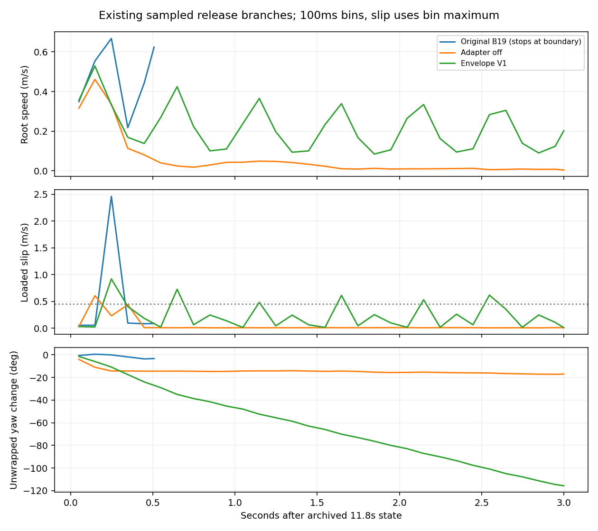

# Read-only mechanism audit: CPR, Guidance and adapter recovery

**Status: diagnosis and review-only proposal; no new physics, no optimizer step, no B/C training.** Factual base `9441ec36a15ef423f79cbf6ac066c62dc575c288`; V1 failure remains unchanged. No new Envelope, reward or physical/success threshold. All CPU offline passes explicitly hide CUDA; no environment is constructed. Reports/aggregate artifacts are written in an isolated audit worktree; experiment runtimes/assets remain read-only.

## Findings and recommendation

**Worth one tightly bounded, conditional B-only mechanism test; not enough evidence to restart full B/C.** The concrete gap is domain-specific action retention: native CPR preserves a small native standing domain under a jointly changing z/action, while visited recovery states are only directly optimized through a lightly trained Q. Existing physical adapter-off intervention establishes material adapter contribution at one shared release state. Return-to-Prior addresses this gap, but broad recovery validity is not established. If the additional predeclared independent base-recovery controls fail, end this repair recipe; no second coefficient/clip sweep.

Confirmed: (1) native CPR is not same-z adapter return; (2) native protection and visited recovery domains differ; (3) actual bad-parent recovery sampling is sparse despite substantial total recovery replay; (4) residuals persist at many joints after release; (5) unchanged V1 blocks much of a post-projection return gradient at the examined state. Compatible: Q extrapolation and function drift jointly sustain unwanted residuals. Unproven: this is the unique cause, Return loss is sufficient, or U/physical source recovery is generally adequate.

## 1. Actual optimization contract, with code evidence

Source links are pinned to [agent.py@9441ec3](https://github.com/luoxinyuan/compliance_BFM/blob/9441ec3/research/interaction_fb/agent.py), unchanged objective from original training runtime62d55b0. This Issue62 implementation is replay-based deterministic actor/Q optimization; it is not the earlier Gaussian PPO experiment.

| Component | Actual target / gradient route | Source |
|---|---|---|
| Guidance U | (standing+U(deploy,standing))/16 → legal norm16 z → real five-substep interpolation | agent39–54 |
| B adapter | adapter(deploy,current interpolated z,zero interactionz), added to frozen BFM output; V1 only changes final execution projection | agent54–66 |
| Physical Q | MSE to real integral reward + .99^(duration/.1) × nonterminal targetQ(nextobs,targetactor action/z); actual replayaction input | agent78–111 |
| Native action CPR | ea=current action(eo) vs old=frozen BFM(eo,stored native ez); mean(((ea−old)×scale)^2)/.01, weighted.1 in actor loss | agent112–128 |
| Robot discriminator | distinguish native(state,ez) from replay(state,z); softplus classifier; actor adv=softplus(−D(replaystate,currentz)), weighted.01 | agent114–127 |
| B actor | −Q +.1CPR +.01adv. Only U/adapter optimizers stepped; no extra recovery action target | agent120–136 |
| C increment | additional successor-density/orthogonality and −.01SF term; B has neither | agent86–108,126–128 |
| Targets / sampling | Polyak1% per update; uniform row sampling with replacement from growing replay and independently from native pool | agent78,139–141; benchmark195–205 |

**CPR z values are not guaranteed equal.** ea calls action(eo), which recomputes Guidance and stored interpolation; old explicitly receives e['z']. No equality assertion or z_override=ez exists in this path. Native prefix Proxy keeps slot0; all760 stored native examples are slot0. At frozen B19, all495 unique native rows that were actually selected at some update have unequal z: angle median3.67903°, p903.68025°. This retrospective frozen-B19 calculation does not pretend to be historical per-update outputs.

Native mixed-z q-equivalent RMS median0.005780rad vs same-z adapter correction0.006703rad. All495 have opposing adapter versus z-shift directions (negative dot cosine): compensation is possible while the total CPR error stays small. This is a legitimate *joint native behaviour preservation* objective, not automatically a bug. It does not identify adapter=0 at currentz or protect all visited states.

`adv` contains state andz, **not adapter action**: its direct adapter gradient is zero. In B, visited-state adapter gradients come from −Q plus generalization of native CPR. U's current action branch gets direct Guidance gradients only at slot0 (other slots use stored targetz); native CPR's records are allslot0. Counts do not imply equivalent effective regularization of U and adapter.

Frozen B19 has38 Q/actor updates. Qloss median0.00138248 is a one-step bootstrapped fit metric, not proof of physically correct recovery ranking. At the shared11.8s state, Q scores same-z base 0.249947, old adapted mean 0.262278, V1 actual sample 0.256459. This ordering prefers the adapted candidate even though archived mean/off interventions show the adapted continuation fails and off recovers better. It is compatible with Q extrapolation/credit error; a one-action Q query and a3s continuation are different contracts, so no claim of a mathematically isolated critic cause.

## 2. Existing physical intervention and joint decomposition

Authoritative archives: diagnosis runs/sample-B19 andmean-B19; adapter-off runs/offsample-B19 andoffmean-B19; Envelope runs/qualification-B19-01/envelope-sample. Exact paths and SHA in prior reports, current [compact metrics](adapter_return_audit/trajectory-decomposition.json). All branches start from the saved full11.8s state, same model/RNG/input for matched sample/mean interventions; external force0. Original on ends at hard boundary after.51s; do not compare its short average as a3s success.

The table's adapter column is *noiseless mean action correction at each actually visited state*; V1 actual executed correction including noise remains the old audited median.10269844rad/max.12rad. Its no-noise diagnostic is.102883rad; these are different quantities, not a numerical violation or revised result. CPU base replay max normalized-action difference≤1.014e-5 against saved NVIDIA outputs; CPU results are sensitivity measurements, not exact NVIDIA equality claims. Native-action CPU validation max1.1623e-6 normalized-action units; no physical rerun.

| Existing branch | Duration s | Median adapter RMS29 rad | Median current-U qPD effect rad | Largest20ms qPD jump rad | End root speed m/s | Loaded slip peak/p95 m/s |
|---|---:|---:|---:|---:|---:|---:|
| on_sample | 0.515 | 0.235975 | 0.023548 | 0.785362 | 0.668848 | 2.462716/0.329106 |
| on_mean | 0.510 | 0.235100 | 0.022709 | 0.793748 | 0.609022 | 2.379839/0.328603 |
| off_sample | 3.000 | 0.000000 | 0.005558 | 0.357324 | 0.004686 | 0.606027/0.021672 |
| off_mean | 3.000 | 0.000000 | 0.005715 | 0.417472 | 0.001618 | 0.524111/0.021964 |
| envelope_sample | 3.000 | 0.102883 | 0.014407 | 0.586481 | 0.202657 | 0.919526/0.150268 |

The U counterfactual is computed only at actual100ms decision boundaries: hold robotobs and actualpreviousz fixed; replace *current* U target by standing; execute the same interpolation formula and frozen actor offline. It does not erase past U history and is not an alternative physical rollout. At the first shared state U-only qPD RMS≈.024009rad, while adapted correction is much larger. U is not proved harmless: later states/history and original BFM feedback differ between real branches.

Continuity includes the very firstnewtarget against exact savedprewindowlastq, cross-checked with archivedq_PD_step_max. Onsample firstjump.144542rad, offsample.319941rad, V1.227210rad: smaller firstjump alone does not predict the betterclosedloop; off stillrecoversbetter.

Original on_sample leftanklepitch adapter signedmean−.339288rad, maxabs.354918; actual qmin−.894054rad andmax|dq|9.78074rad/s; qPD minimum−1.609251rad. Maximum target jump.785362rad is **a target jump, not actual joint rotation in20ms**. Changes are distributed: rightwristroll +.335392, rightelbow +.317344, leftankleroll +.309179rad mean, plus hip/shoulder corrections. A single ankle limit does not describe the full residual.

V1 still applies sustained near.12rad corrections to many hips/knees/shoulders; actual leftanklepitch stays withinrange, but correction RMS remains≈.103rad. Existing relative-slip failures remain peak.919526>.727233 andp95.150268>.041672. Unwrapped pelvis change across the recorded3s is−115.625° versus offsample−17.079°; **this is descriptive, not a replacement for locked world-absolute yaw criterion**. Rootdisplacement from restored pre-qpos is.431571m versus off.096439m; old9441ec3 uses first5mstick origin (.430761/.095695m), difference<1mm, no physical result changed.

Full29-joint per-branch signed residual, qPD, actualq/dq, targetcontinuity and U-sensitivity tables are in the appendix and JSON. Saved physics supplies actualq/dq; exact saved controls supply qPD. No different-state action comparison is treated as an intervention. The already-executed adapter-off experiment supplies the physical causal evidence, confined to this state.

## 3. Actual recovery coverage and update exposure

Actual replay4750rows=95s,10episodes/8parentIDs (stop/continue shareparent). NativeCPR760rows=15.2s across10prefix records, allsource standing, allinactive, time3.0→4.08–4.68s;8sourcegroups, not760independentstarts. Zero-demand and no-contact full episodes were later in the deterministic manifest order and had **not been visited when B stopped**. Source state order is `env.reset((spec_id+1)%len(specs))`, not randomized episode probabilities; see env67–76 and benchmark95–101. This is an actual coverage limit, not a claimed change to the locked curriculum.

| Actual phase | Rows | Duration s | Parent IDs / episodes | Actual replay draws | Unique rows drawn |
|---|---:|---:|---:|---:|---:|
| active | 2590 | 51.80 | 8/10 | 713 | 567 |
| pre_onset | 310 | 6.20 | 8/10 | 89 | 71 |
| release_.5_1 | 250 | 5.00 | 8/10 | 54 | 46 |
| release_0_.5 | 250 | 5.00 | 8/10 | 53 | 44 |
| release_1_2 | 450 | 9.00 | 7/9 | 95 | 78 |
| release_2plus | 900 | 18.00 | 7/9 | 212 | 179 |

Inactive2160rows include310pre-onset +1850released. Recovery37s has414/1216 draws (34.05%) but only347unique rows (18.76% of1850), from8parents; nativeCPR has its own1216draws/495unique indices and **no visited recovery input**. It is incorrect to say all recovery was starved, or to treat inactive count as sufficient protection.

Bad parent8dde57ea has50releasedrows/.99999998s in committed B19; exactly one replay draw, **update37,index4746,time11.72s,slot1**; update38 contains no recovery from thatparent. The exact11.8s failure-boundary observation has not been directly sampled as actorinput in the committed updates. It can occur as a stored successor; that is not equal to training a recovery action there. NativeCPR never samples it. The sole selected recoveryrow is slot1, so its actorcall uses storedtargetz and gives no direct Utaskgradient; it still trains Q andadapter. This doesnotruleout indirectsharedfunctionchanges or nativeCPRinfluence onU. All actual indices are retained in the compact coverage asset.

Counterevidence against a universal recovery failure: first8episodes (6independentparents) have archived release slippeaks .00659–.01337m/s and endingroot speeds .00521–.02310m/s under the then-current policy. The ninth near episode already rises to slippeak.640565, end speed.109224; tenth mid first1s reaches.900102/.220424. These were produced by different historical weights and visited states; they do not prove currentB19 would still recover on early-domain states. They show *drift plus shifted recovery-state coverage* is more precise than “there is no stable recovery experience”.

### Matched actual reward versus frozen Q (archived data)

Same3s actual native-time discount, no re-simulation: offsample return−0.276294539; offmean−0.258801925; V1sample−1.011020664. V1 discountedcost: idle.844753491 +slip.128265670 +continuity.036718750 +tilt.001282753. Offsample: idle.230660619 +slip.027714289 +continuity.017506788 +tilt.000412842. Existingreward correctly prefers off for thiswindow; no evidence here that reward prefers unwantedcontinuingmotion. FrozenQ instead scores base.249947 <V1firstsample.256459 <oldadaptedmean.262278. This is a *local discrepancy*: finite3s actualreturn and bootstrappedinfinitehorizonQ are distinct, so it is not a proven Qimplementationbug.

Reward source `dual_track_task.py:103–126,307–321`: force/tracking/relativevelocity/heading inactive afteractualrelease; slip/tilt/continuity/idle remain. Sliptrainingcost uses generalcontact_tangent_speed and saturates at.8 rate, while physicalqualification reports loadedstage_slip; they are not the samequantity. No rewardterm, loadedslipgate or postreleaseanchor criterion was changed. [Actual component sums](adapter_return_audit/matched-recovery-reward.json).

## 4. Does same-z Adapter Return-to-Prior target a real gap?

Yes, as a **new, domain-qualified adapter constraint**, not as another clip. Reference is frozenBFM at the *same current legal interpolatedz*, robotobservation and real executedhistory. No stored nativez substitution; no U reset. Stopgradient through reference and currentz for this addedloss, so its direct purpose is adapterreturn, not forcing a new Guidance task. Native CPR continues protecting its existing joint domain.

But the naive *post-Envelope* squared action penalty has a weakness. At the shared qualified11.8s state, 79.31% of adapter output components have exactlyzero return gradient from genuine clip saturation; parametergradient is nonzero via otheroutputs/sharedweights. This is expected clamp calculus, **not a gradient implementation bug or proof learning is impossible**. The existing V1 numeric amendment does not cure it.

A minimally distinguishable proposal is Return on the **pre-Envelope raw adapter correction in joint-equivalent units**, while keeping the exact existing Envelope for every actual action, Q/target and replay. Define L_R=mean[(scale×adapter_raw(x,stopgrad(z)))²]/.01 on a whitelist of actually validated free-recovery/source records. `scale×adapter_raw` is a *training proxy*, not an executedqPD or physical range assertion. It retains gradients on saturated proposals; it does not introduce a new clipping rule. Log actual post-Envelope correction alongside it.

At the single archived11.8s state: raw-return gradientnorm120.862366, projected task gradientnorm0.048558; post-return gradientnorm2.148370. λ=.1 copied mechanically from CPR would be excessive (old unprojected comparator≈99×taskgradient). Suggested **fixed λ_R=.0008** gives≈1.99×projected taskgradient for the rawreturn proxy at this state, rounded from2×normratio .000803526. This is an explicitly local calibration, not an optimum or multi-parent guarantee. No coefficient scan; actual multi-parent gradient ratios would be logged without retuning.

Risks / falsifiers: base-off itself fails absolute slip/yaw at thisstate; unchangedz/lastz can still request motion; base may not recover from other off-manifold states; useful contact adaptations may share inputs/features with recovery. Strong regularization can slow balance correction, continued walking or force-following and may pull against native CPR's jointz compensation. Loss must be training-only over qualifiedstate membership; **no runtime rule force=0→adapter=0**, no new active truth/clock/partner target fed toactor. A raw loss can shrink proposals without improving dynamics. If independentphysical recovery does not improve, stop this hypothesis rather than increaseλ.

A remains its frozenexisting reference. Any later formal B/C comparison must share exactly the same Return definition/coefficient/data/masks/Envelope/noise; C's additionalrepresentation objectives remain its only intendedincrement. This B-only mechanism pilot cannot be used to claim C benefit, to replace A, or to retroactively pass V1.

## 5. Evidence grades and unresolved alternatives

| Statement | Grade / boundary |
|---|---|
| CPR has different latent arguments and native-only data | Confirmed by code and actual indices; not automatically a bug |
| Adapter materially contributed to this B19 recovery failure | Confirmed by existing exact on/off physical intervention at one state |
| Fixed Envelope alone restores recovery | Refuted by preserved V1slip/root result |
| All recovery absent or nevertrained | Refuted:37s/414draws; specific late recovery barely sampled |
| Q/actor points away from prior at the sharedstate | Confirmed local gradient fact; old no-Envelope loss cosine−.8276; not proof full causalcriticfailure |
| Currentz/U alone explains allfailure | Unproven; same initialU retained in successfuloffbranch, U-only sensitivity smaller here |
| Returnwillgeneralize toother recovery states without activecost | Unproven; requires independent qualifieddomains and physicalpilot |

The best-supported explanation is **native-domain compensation can satisfy CPR while the adapter grows on policyvisited free-recovery states; taskQ is the direct driver there, and its local actionpreference need not match true recovery quality. Distribution shifts and sparse late-domain feedback matter.** Neither drift alone norcritic alone is established as unique cause. No newtraining or frozenverdict revision is justified by lowoffline loss.

## Read-only provenance and cost

Source/runtime scientificreference9441ec3; actual oldV1runtimee4c2d3f unchanged. FrozenB19core0cd3e3684d764cad42caaa83773b885868caeed0557dba1780ec36a3d03a3984, BFM33f410c1…e361 verified onCPU; full identities in priorresult and JSON. Hash-verified archived manifests/deltas loaded, not rewritten. CPU inputs contain saved genuinehistories; no envconstructor, mj_step, source reset or optimizer.step. Two complete analysis passes (second fixes CPU diagnostic base-reference choice; no changes to originalNVIDIA trace), small gradient-only passes; failed local-script-name import attempt retained. No GPU initialization. This audit's conservative CPU/IO/preparation/reporting upper charge is3600jobseconds, separate from unchanged10.279462h stoppedPilotledger; no new training budget consumed. Outputaudit only, futuretrial notstarted. See draft ADAPTER_RETURN_TO_PRIOR_PILOT_DRAFT.md.

## Appendix: per-joint archival decomposition

Adapter terms are no-noise same-state mean effects; originalon/off fromsavedmeans, V1 mean reconstructed offline using savedNVIDIA base and savedadapter. U effect is boundary-only counterfactualRMS. q/dq are actualphysics. Targets can lie outside mechanical range while actualjoint doesnot; target jumps are not actual20ms jointrotations.

| Branch | Joint | Adaptermean rad | Maxabs rad | qPD min..max rad | Actualq min..max rad | Maxabs dq rad/s | Max20ms qPDjump rad | Uboundary qPD RMS rad |
|---|---|---:|---:|---:|---:|---:|---:|---:|
| on_sample | left_hip_pitch_joint | -0.287762 | 0.301122 | -1.108156..-0.491352 | -1.001043..-0.757673 | 2.513281 | 0.171423 | 0.007477 |
| on_sample | left_hip_roll_joint | 0.267586 | 0.280180 | 0.336711..1.330855 | 0.419305..0.921089 | 5.108592 | 0.539730 | 0.047977 |
| on_sample | left_hip_yaw_joint | 0.261131 | 0.272351 | -0.350992..0.665206 | 0.376331..0.759603 | 2.361190 | 0.421530 | 0.013625 |
| on_sample | left_knee_joint | 0.245132 | 0.256356 | 0.210613..1.388351 | 0.900999..1.313085 | 6.874607 | 0.610370 | 0.032380 |
| on_sample | left_ankle_pitch_joint | -0.339288 | 0.354918 | -1.609251..-0.003597 | -0.894054..-0.239361 | 9.780742 | 0.785362 | 0.056339 |
| on_sample | left_ankle_roll_joint | 0.309179 | 0.322995 | 0.111613..0.703094 | 0.113215..0.268457 | 5.114677 | 0.341660 | 0.012949 |
| on_sample | right_hip_pitch_joint | -0.278065 | 0.290627 | -1.347367..-0.695567 | -1.201774..-0.898142 | 1.601951 | 0.195045 | 0.013741 |
| on_sample | right_hip_roll_joint | -0.264524 | 0.276693 | -0.544026..-0.257669 | -0.377434..-0.172766 | 1.678201 | 0.189685 | 0.033884 |
| on_sample | right_hip_yaw_joint | 0.214678 | 0.224434 | -0.239189..0.412400 | -0.232724..0.032325 | 1.654433 | 0.298095 | 0.052453 |
| on_sample | right_knee_joint | 0.273359 | 0.286042 | 0.890046..1.909215 | 1.018663..1.720625 | 5.640562 | 0.507620 | 0.127315 |
| on_sample | right_ankle_pitch_joint | 0.227915 | 0.238431 | -0.733731..1.448945 | -0.444367..0.253124 | 5.299580 | 0.734463 | 0.279452 |
| on_sample | right_ankle_roll_joint | 0.185974 | 0.193892 | 0.053976..0.317021 | 0.043868..0.208502 | 2.089572 | 0.119837 | 0.017133 |
| on_sample | waist_yaw_joint | -0.082738 | 0.085343 | -0.295794..-0.205832 | -0.300917..-0.203683 | 0.944315 | 0.015681 | 0.003120 |
| on_sample | waist_roll_joint | 0.036394 | 0.045496 | 0.134759..0.208333 | 0.161120..0.239746 | 2.129535 | 0.019706 | 0.005503 |
| on_sample | waist_pitch_joint | -0.016662 | 0.017256 | -0.160159..-0.095775 | -0.124874..-0.078869 | 0.848514 | 0.022813 | 0.003771 |
| on_sample | left_shoulder_pitch_joint | -0.282872 | 0.295678 | -0.554799..-0.173386 | -0.263876..-0.248195 | 0.529098 | 0.099337 | 0.035142 |
| on_sample | left_shoulder_roll_joint | -0.305296 | 0.319593 | -0.353001..-0.012770 | -0.052663..-0.047763 | 0.293862 | 0.157329 | 0.012552 |
| on_sample | left_shoulder_yaw_joint | -0.240429 | 0.251010 | -0.333186..-0.232966 | -0.266946..-0.231716 | 0.561716 | 0.060279 | 0.014937 |
| on_sample | left_elbow_joint | 0.249337 | 0.260510 | 0.197123..0.404542 | 0.314131..0.440969 | 0.785462 | 0.067221 | 0.028746 |
| on_sample | left_wrist_roll_joint | 0.286626 | 0.299581 | 0.266828..0.540032 | 0.295334..0.485197 | 1.474214 | 0.115940 | 0.018033 |
| on_sample | left_wrist_pitch_joint | -0.062797 | 0.065343 | -0.196239..-0.056210 | -0.158873..-0.048037 | 0.974336 | 0.034520 | 0.007231 |
| on_sample | left_wrist_yaw_joint | 0.017061 | 0.037875 | 0.362247..0.372504 | 0.361383..0.368233 | 0.116761 | 0.010257 | 0.011203 |
| on_sample | right_shoulder_pitch_joint | 0.148074 | 0.154048 | -0.400888..-0.072617 | -0.212913..0.025221 | 1.263216 | 0.200094 | 0.033851 |
| on_sample | right_shoulder_roll_joint | -0.197116 | 0.205919 | -0.446440..-0.055365 | -0.171058..-0.037377 | 0.666668 | 0.152120 | 0.027097 |
| on_sample | right_shoulder_yaw_joint | -0.295675 | 0.309350 | -0.679379..-0.415170 | -0.623552..-0.476120 | 1.200174 | 0.083221 | 0.016887 |
| on_sample | right_elbow_joint | 0.317344 | 0.331946 | 0.291507..0.627760 | 0.428130..0.641162 | 1.875312 | 0.108739 | 0.027367 |
| on_sample | right_wrist_roll_joint | 0.335392 | 0.351045 | 0.658321..0.817595 | 0.628945..0.746945 | 1.184570 | 0.083204 | 0.006018 |
| on_sample | right_wrist_pitch_joint | -0.045193 | 0.047154 | -0.265843..-0.190363 | -0.235659..-0.180265 | 0.378567 | 0.016665 | 0.002922 |
| on_sample | right_wrist_yaw_joint | -0.055868 | 0.060873 | -0.372504..-0.076253 | -0.339771..-0.138098 | 2.022362 | 0.065949 | 0.005397 |
| on_mean | left_hip_pitch_joint | -0.286913 | 0.298787 | -1.084121..-0.529499 | -1.000182..-0.748684 | 2.487532 | 0.148427 | 0.006787 |
| on_mean | left_hip_roll_joint | 0.266779 | 0.278032 | 0.331234..1.318010 | 0.411450..0.926412 | 4.814458 | 0.536332 | 0.046704 |
| on_mean | left_hip_yaw_joint | 0.260387 | 0.270060 | -0.228849..0.716019 | 0.379987..0.785340 | 2.165652 | 0.393107 | 0.016655 |
| on_mean | left_knee_joint | 0.244402 | 0.254314 | 0.182852..1.292222 | 0.898985..1.269614 | 6.932900 | 0.542371 | 0.020002 |
| on_mean | left_ankle_pitch_joint | -0.338286 | 0.352194 | -1.452688..-0.080027 | -0.900229..-0.192644 | 11.277688 | 0.420988 | 0.057234 |
| on_mean | left_ankle_roll_joint | 0.308276 | 0.320423 | 0.124336..0.721758 | 0.100759..0.269179 | 4.975899 | 0.323149 | 0.013832 |
| on_mean | right_hip_pitch_joint | -0.277260 | 0.288370 | -1.324301..-0.706150 | -1.207781..-0.898642 | 1.614431 | 0.152779 | 0.014957 |
| on_mean | right_hip_roll_joint | -0.263747 | 0.274477 | -0.549890..-0.284063 | -0.354461..-0.174442 | 1.450693 | 0.209439 | 0.030623 |
| on_mean | right_hip_yaw_joint | 0.214038 | 0.222624 | -0.253985..0.368902 | -0.235429..0.041497 | 1.998217 | 0.254146 | 0.040527 |
| on_mean | right_knee_joint | 0.272548 | 0.283790 | 0.866336..1.894978 | 1.020159..1.697813 | 5.532020 | 0.537756 | 0.077586 |
| on_mean | right_ankle_pitch_joint | 0.227226 | 0.236477 | -0.719523..1.452232 | -0.383401..0.250659 | 5.459096 | 0.793748 | 0.271008 |
| on_mean | right_ankle_roll_joint | 0.185446 | 0.192268 | 0.077738..0.246537 | 0.044197..0.215182 | 1.322246 | 0.094714 | 0.012627 |
| on_mean | waist_yaw_joint | -0.082558 | 0.085346 | -0.293653..-0.208651 | -0.293878..-0.201943 | 0.889793 | 0.020672 | 0.002892 |
| on_mean | waist_roll_joint | 0.035491 | 0.045965 | 0.130242..0.208333 | 0.156746..0.242499 | 2.070351 | 0.021971 | 0.003859 |
| on_mean | waist_pitch_joint | -0.016620 | 0.017095 | -0.157137..-0.096139 | -0.127220..-0.078758 | 0.855819 | 0.021120 | 0.003642 |
| on_mean | left_shoulder_pitch_joint | -0.282045 | 0.293306 | -0.519098..-0.145660 | -0.263577..-0.242650 | 0.549523 | 0.115280 | 0.033825 |
| on_mean | left_shoulder_roll_joint | -0.304389 | 0.317144 | -0.343373..-0.012890 | -0.052022..-0.046298 | 0.278057 | 0.101057 | 0.008300 |
| on_mean | left_shoulder_yaw_joint | -0.239742 | 0.248982 | -0.363095..-0.233054 | -0.278154..-0.238839 | 0.673306 | 0.087641 | 0.011805 |
| on_mean | left_elbow_joint | 0.248607 | 0.258368 | 0.204225..0.409437 | 0.314183..0.446834 | 0.911372 | 0.060997 | 0.029426 |
| on_mean | left_wrist_roll_joint | 0.285792 | 0.297213 | 0.259216..0.546757 | 0.294408..0.467271 | 1.250712 | 0.070026 | 0.017740 |
| on_mean | left_wrist_pitch_joint | -0.062631 | 0.064830 | -0.188107..-0.074838 | -0.152444..-0.062866 | 0.803245 | 0.028573 | 0.007212 |
| on_mean | left_wrist_yaw_joint | 0.020892 | 0.042979 | 0.372504..0.372504 | 0.361823..0.371398 | 0.144019 | 0.000000 | 0.012511 |
| on_mean | right_shoulder_pitch_joint | 0.147676 | 0.152720 | -0.375282..-0.029502 | -0.209784..-0.001577 | 1.157054 | 0.145480 | 0.032320 |
| on_mean | right_shoulder_roll_joint | -0.196539 | 0.204217 | -0.428331..-0.055489 | -0.159649..-0.036257 | 0.570347 | 0.137118 | 0.026753 |
| on_mean | right_shoulder_yaw_joint | -0.294802 | 0.306894 | -0.677902..-0.432221 | -0.620756..-0.473646 | 0.899826 | 0.081979 | 0.014435 |
| on_mean | right_elbow_joint | 0.316404 | 0.329357 | 0.288893..0.628062 | 0.428357..0.641143 | 1.753962 | 0.118939 | 0.027931 |
| on_mean | right_wrist_roll_joint | 0.334389 | 0.348279 | 0.670543..0.827982 | 0.627820..0.764235 | 1.046169 | 0.046332 | 0.005029 |
| on_mean | right_wrist_pitch_joint | -0.045061 | 0.046774 | -0.263185..-0.198272 | -0.221213..-0.187778 | 0.276775 | 0.017552 | 0.003023 |
| on_mean | right_wrist_yaw_joint | -0.055259 | 0.060382 | -0.372504..-0.083716 | -0.337945..-0.133608 | 2.137661 | 0.066539 | 0.004015 |
| off_sample | left_hip_pitch_joint | 0.000000 | 0.000000 | -0.894866..-0.115962 | -0.885750..-0.220240 | 2.571134 | 0.233141 | 0.003369 |
| off_sample | left_hip_roll_joint | 0.000000 | 0.000000 | 0.045092..0.411058 | 0.166483..0.496435 | 2.178280 | 0.271015 | 0.012931 |
| off_sample | left_hip_yaw_joint | 0.000000 | 0.000000 | -0.053035..0.207201 | 0.082358..0.429076 | 4.053456 | 0.245182 | 0.005858 |
| off_sample | left_knee_joint | 0.000000 | 0.000000 | 0.303303..1.052402 | 0.317893..1.245119 | 4.083692 | 0.227094 | 0.007444 |
| off_sample | left_ankle_pitch_joint | 0.000000 | 0.000000 | -0.334551..0.625976 | -0.622415..-0.087453 | 4.533000 | 0.298043 | 0.011457 |
| off_sample | left_ankle_roll_joint | 0.000000 | 0.000000 | -0.179501..0.020412 | -0.126539..0.192248 | 4.248185 | 0.319941 | 0.003159 |
| off_sample | right_hip_pitch_joint | 0.000000 | 0.000000 | -0.525956..-0.107956 | -0.880127..-0.145303 | 2.390801 | 0.227660 | 0.004945 |
| off_sample | right_hip_roll_joint | 0.000000 | 0.000000 | -0.344128..0.135241 | -0.170650..0.006317 | 0.947460 | 0.318883 | 0.008505 |
| off_sample | right_hip_yaw_joint | 0.000000 | 0.000000 | -0.245705..0.267413 | -0.101685..0.004724 | 1.247387 | 0.310611 | 0.005003 |
| off_sample | right_knee_joint | 0.000000 | 0.000000 | 0.211326..0.732348 | 0.290454..1.011495 | 2.642707 | 0.243509 | 0.004653 |
| off_sample | right_ankle_pitch_joint | 0.000000 | 0.000000 | -0.345470..1.059182 | -0.329544..-0.156640 | 4.342548 | 0.357324 | 0.009068 |
| off_sample | right_ankle_roll_joint | 0.000000 | 0.000000 | -0.199890..0.074039 | 0.005214..0.097541 | 1.122467 | 0.137551 | 0.005137 |
| off_sample | waist_yaw_joint | 0.000000 | 0.000000 | -0.138828..0.031441 | -0.202204..0.031289 | 2.305252 | 0.077611 | 0.001081 |
| off_sample | waist_roll_joint | 0.000000 | 0.000000 | 0.033226..0.114087 | 0.040774..0.165190 | 1.071772 | 0.040974 | 0.000963 |
| off_sample | waist_pitch_joint | 0.000000 | 0.000000 | -0.142519..0.016223 | -0.089290..0.037358 | 3.391697 | 0.028826 | 0.000681 |
| off_sample | left_shoulder_pitch_joint | 0.000000 | 0.000000 | -0.156603..-0.017891 | -0.267622..0.036027 | 2.268970 | 0.240912 | 0.012632 |
| off_sample | left_shoulder_roll_joint | 0.000000 | 0.000000 | -0.092182..0.275878 | -0.052555..0.008335 | 0.592220 | 0.250658 | 0.003611 |
| off_sample | left_shoulder_yaw_joint | 0.000000 | 0.000000 | -0.161932..0.120323 | -0.242810..-0.016557 | 2.835023 | 0.182661 | 0.005261 |
| off_sample | left_elbow_joint | 0.000000 | 0.000000 | -0.203712..0.080893 | -0.030782..0.311624 | 2.951330 | 0.194109 | 0.013076 |
| off_sample | left_wrist_roll_joint | 0.000000 | 0.000000 | -0.349130..0.065727 | -0.315399..0.286890 | 4.837614 | 0.214039 | 0.003119 |
| off_sample | left_wrist_pitch_joint | 0.000000 | 0.000000 | -0.074917..0.042066 | -0.060593..0.051799 | 0.513192 | 0.043793 | 0.004962 |
| off_sample | left_wrist_yaw_joint | 0.000000 | 0.000000 | 0.008220..0.355711 | 0.022371..0.360021 | 1.279268 | 0.030295 | 0.004087 |
| off_sample | right_shoulder_pitch_joint | 0.000000 | 0.000000 | -0.383946..-0.075140 | -0.165580..-0.030286 | 0.920678 | 0.109196 | 0.013266 |
| off_sample | right_shoulder_roll_joint | 0.000000 | 0.000000 | -0.233461..0.221439 | -0.044897..0.010609 | 1.128127 | 0.154683 | 0.006017 |
| off_sample | right_shoulder_yaw_joint | 0.000000 | 0.000000 | -0.159936..0.073240 | -0.491294..0.045737 | 3.795012 | 0.303306 | 0.006606 |
| off_sample | right_elbow_joint | 0.000000 | 0.000000 | -0.007009..0.261472 | 0.161192..0.423636 | 1.172048 | 0.240769 | 0.016000 |
| off_sample | right_wrist_roll_joint | 0.000000 | 0.000000 | 0.112578..0.369622 | 0.153133..0.619335 | 2.925004 | 0.277855 | 0.002252 |
| off_sample | right_wrist_pitch_joint | 0.000000 | 0.000000 | -0.152981..0.071562 | -0.188290..0.080334 | 1.038921 | 0.037095 | 0.001431 |
| off_sample | right_wrist_yaw_joint | 0.000000 | 0.000000 | -0.198998..0.353664 | -0.324892..0.274329 | 4.067951 | 0.099640 | 0.001191 |
| off_mean | left_hip_pitch_joint | 0.000000 | 0.000000 | -0.888769..-0.156992 | -0.884385..-0.239542 | 2.301828 | 0.241142 | 0.002971 |
| off_mean | left_hip_roll_joint | 0.000000 | 0.000000 | 0.091004..0.389368 | 0.173379..0.494134 | 2.182622 | 0.296742 | 0.013017 |
| off_mean | left_hip_yaw_joint | 0.000000 | 0.000000 | -0.051904..0.196322 | 0.088616..0.429924 | 4.095146 | 0.239381 | 0.005658 |
| off_mean | left_knee_joint | 0.000000 | 0.000000 | 0.336399..1.044858 | 0.323069..1.243975 | 3.947221 | 0.234638 | 0.007316 |
| off_mean | left_ankle_pitch_joint | 0.000000 | 0.000000 | -0.333085..0.657220 | -0.622240..-0.085515 | 6.812000 | 0.417472 | 0.011150 |
| off_mean | left_ankle_roll_joint | 0.000000 | 0.000000 | -0.169316..0.017567 | -0.126655..0.193369 | 4.013686 | 0.303184 | 0.003147 |
| off_mean | right_hip_pitch_joint | 0.000000 | 0.000000 | -0.507198..-0.171205 | -0.880624..-0.166592 | 2.247312 | 0.229329 | 0.005064 |
| off_mean | right_hip_roll_joint | 0.000000 | 0.000000 | -0.346609..0.106874 | -0.172372..0.000558 | 0.902648 | 0.256485 | 0.008293 |
| off_mean | right_hip_yaw_joint | 0.000000 | 0.000000 | -0.254841..0.217916 | -0.100469..-0.001854 | 0.844114 | 0.220246 | 0.004692 |
| off_mean | right_knee_joint | 0.000000 | 0.000000 | 0.237151..0.746499 | 0.306651..1.013038 | 2.299066 | 0.256966 | 0.005131 |
| off_mean | right_ankle_pitch_joint | 0.000000 | 0.000000 | -0.366824..1.062094 | -0.330985..-0.164424 | 4.294553 | 0.340206 | 0.008985 |
| off_mean | right_ankle_roll_joint | 0.000000 | 0.000000 | -0.171657..0.078668 | 0.012285..0.103240 | 1.470331 | 0.112030 | 0.005177 |
| off_mean | waist_yaw_joint | 0.000000 | 0.000000 | -0.139384..0.023564 | -0.202757..0.024078 | 2.217064 | 0.077055 | 0.001111 |
| off_mean | waist_roll_joint | 0.000000 | 0.000000 | 0.042156..0.116412 | 0.045960..0.163129 | 1.159103 | 0.044709 | 0.000945 |
| off_mean | waist_pitch_joint | 0.000000 | 0.000000 | -0.139975..0.003345 | -0.088923..0.030371 | 3.464980 | 0.027511 | 0.000687 |
| off_mean | left_shoulder_pitch_joint | 0.000000 | 0.000000 | -0.108789..-0.026928 | -0.268342..0.045582 | 2.331310 | 0.234684 | 0.012868 |
| off_mean | left_shoulder_roll_joint | 0.000000 | 0.000000 | -0.081654..0.260313 | -0.052765..0.006654 | 0.688049 | 0.226677 | 0.003956 |
| off_mean | left_shoulder_yaw_joint | 0.000000 | 0.000000 | -0.128089..0.128958 | -0.242720..-0.010040 | 2.741624 | 0.182923 | 0.005417 |
| off_mean | left_elbow_joint | 0.000000 | 0.000000 | -0.192151..0.039599 | -0.036949..0.311598 | 3.001340 | 0.190417 | 0.013285 |
| off_mean | left_wrist_roll_joint | 0.000000 | 0.000000 | -0.288160..0.037418 | -0.281656..0.285955 | 4.674723 | 0.237816 | 0.003086 |
| off_mean | left_wrist_pitch_joint | 0.000000 | 0.000000 | -0.071269..0.032931 | -0.060729..0.045351 | 0.487488 | 0.041062 | 0.004886 |
| off_mean | left_wrist_yaw_joint | 0.000000 | 0.000000 | 0.009768..0.353969 | 0.021510..0.359922 | 1.314369 | 0.031767 | 0.004087 |
| off_mean | right_shoulder_pitch_joint | 0.000000 | 0.000000 | -0.383514..-0.130647 | -0.163893..-0.049917 | 0.817044 | 0.123932 | 0.013464 |
| off_mean | right_shoulder_roll_joint | 0.000000 | 0.000000 | -0.191402..0.219161 | -0.044272..0.007232 | 0.935919 | 0.128809 | 0.006104 |
| off_mean | right_shoulder_yaw_joint | 0.000000 | 0.000000 | -0.182388..0.053527 | -0.492248..0.039730 | 3.825149 | 0.253776 | 0.006994 |
| off_mean | right_elbow_joint | 0.000000 | 0.000000 | 0.045357..0.231826 | 0.180750..0.423967 | 1.098479 | 0.232851 | 0.016085 |
| off_mean | right_wrist_roll_joint | 0.000000 | 0.000000 | 0.159254..0.337415 | 0.174437..0.618205 | 3.286541 | 0.310062 | 0.002363 |
| off_mean | right_wrist_pitch_joint | 0.000000 | 0.000000 | -0.152787..0.069655 | -0.188173..0.081943 | 0.909996 | 0.037289 | 0.001512 |
| off_mean | right_wrist_yaw_joint | 0.000000 | 0.000000 | -0.203369..0.352505 | -0.324839..0.279262 | 4.062807 | 0.096197 | 0.001053 |
| envelope_sample | left_hip_pitch_joint | -0.120000 | 0.120000 | -0.910204..-0.362269 | -0.903373..-0.515670 | 2.105828 | 0.250673 | 0.013034 |
| envelope_sample | left_hip_roll_joint | 0.120000 | 0.120000 | 0.254689..0.782439 | 0.296793..0.494873 | 1.272822 | 0.194710 | 0.028642 |
| envelope_sample | left_hip_yaw_joint | 0.120000 | 0.120000 | -0.153100..0.562568 | 0.253886..0.519807 | 2.212960 | 0.185992 | 0.016009 |
| envelope_sample | left_knee_joint | 0.120000 | 0.120000 | 0.203032..1.164858 | 0.732649..1.249112 | 5.400568 | 0.372230 | 0.024275 |
| envelope_sample | left_ankle_pitch_joint | -0.102080 | 0.120000 | -0.935327..0.572828 | -0.628718..-0.299947 | 7.014961 | 0.430757 | 0.029857 |
| envelope_sample | left_ankle_roll_joint | 0.069743 | 0.093704 | -0.045493..0.161119 | -0.069022..0.198836 | 2.858688 | 0.227210 | 0.008593 |
| envelope_sample | right_hip_pitch_joint | -0.120000 | 0.120000 | -0.785105..-0.281155 | -0.888076..-0.578302 | 1.850307 | 0.123308 | 0.007611 |
| envelope_sample | right_hip_roll_joint | -0.120000 | 0.120000 | -0.382260..0.067168 | -0.195994..0.007269 | 1.131592 | 0.239488 | 0.024564 |
| envelope_sample | right_hip_yaw_joint | 0.120000 | 0.120000 | -0.194802..0.664352 | -0.103123..0.236250 | 1.821498 | 0.378885 | 0.026929 |
| envelope_sample | right_knee_joint | 0.120000 | 0.120000 | 0.477044..1.166455 | 0.675433..1.044503 | 3.661490 | 0.386764 | 0.019754 |
| envelope_sample | right_ankle_pitch_joint | 0.078449 | 0.120000 | -0.347976..1.041525 | -0.370247..-0.176451 | 2.866907 | 0.586481 | 0.017177 |
| envelope_sample | right_ankle_roll_joint | 0.062182 | 0.120000 | -0.155912..0.139537 | 0.039888..0.170397 | 2.257707 | 0.118493 | 0.008105 |
| envelope_sample | waist_yaw_joint | -0.075916 | 0.083485 | -0.242421..-0.195658 | -0.233768..-0.191730 | 0.580176 | 0.017501 | 0.001377 |
| envelope_sample | waist_roll_joint | 0.037127 | 0.044984 | 0.132290..0.208333 | 0.168286..0.221164 | 1.743559 | 0.034538 | 0.001374 |
| envelope_sample | waist_pitch_joint | -0.014611 | 0.016761 | -0.159280..-0.085644 | -0.105580..-0.048150 | 1.617133 | 0.015525 | 0.002431 |
| envelope_sample | left_shoulder_pitch_joint | -0.120000 | 0.120000 | -0.272539..0.017166 | -0.263488..-0.014934 | 1.678506 | 0.114684 | 0.022075 |
| envelope_sample | left_shoulder_roll_joint | -0.120000 | 0.120000 | -0.216393..0.131112 | -0.051275..-0.017451 | 0.366437 | 0.106677 | 0.007154 |
| envelope_sample | left_shoulder_yaw_joint | -0.120000 | 0.120000 | -0.229999..-0.050463 | -0.241808..-0.094909 | 1.368587 | 0.062923 | 0.005316 |
| envelope_sample | left_elbow_joint | 0.120000 | 0.120000 | -0.026484..0.098870 | 0.144010..0.312085 | 1.293793 | 0.070417 | 0.017008 |
| envelope_sample | left_wrist_roll_joint | 0.120000 | 0.120000 | 0.048709..0.171473 | 0.073344..0.289783 | 2.154629 | 0.117816 | 0.003879 |
| envelope_sample | left_wrist_pitch_joint | -0.055437 | 0.063245 | -0.210950..-0.091903 | -0.173870..-0.062808 | 0.843867 | 0.027994 | 0.006232 |
| envelope_sample | left_wrist_yaw_joint | 0.042923 | 0.062512 | 0.366120..0.372504 | 0.361439..0.371510 | 0.118800 | 0.006384 | 0.006019 |
| envelope_sample | right_shoulder_pitch_joint | 0.120000 | 0.120000 | -0.361467..-0.141989 | -0.176490..-0.074885 | 0.859473 | 0.089710 | 0.015973 |
| envelope_sample | right_shoulder_roll_joint | -0.120000 | 0.120000 | -0.295418..0.084972 | -0.076361..-0.018328 | 0.558896 | 0.115349 | 0.006782 |
| envelope_sample | right_shoulder_yaw_joint | -0.120000 | 0.120000 | -0.344080..-0.171036 | -0.491014..-0.230187 | 2.084469 | 0.133776 | 0.010344 |
| envelope_sample | right_elbow_joint | 0.120000 | 0.120000 | 0.107822..0.332686 | 0.269388..0.441496 | 1.108887 | 0.112851 | 0.016255 |
| envelope_sample | right_wrist_roll_joint | 0.120000 | 0.120000 | 0.338132..0.457415 | 0.363094..0.621916 | 2.079665 | 0.190062 | 0.011332 |
| envelope_sample | right_wrist_pitch_joint | -0.038999 | 0.045485 | -0.222441..-0.126566 | -0.189069..-0.125778 | 0.486503 | 0.019250 | 0.001774 |
| envelope_sample | right_wrist_yaw_joint | -0.049800 | 0.058877 | -0.372504..-0.063943 | -0.356092..-0.113202 | 2.414249 | 0.072977 | 0.001800 |
