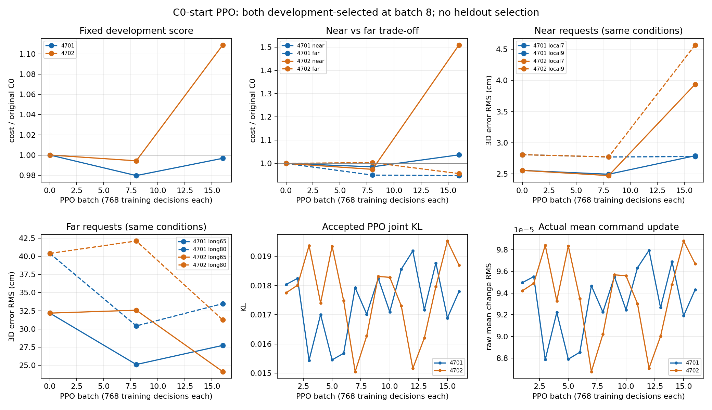

# Issue47：C0局部响应与延迟全身参与

2026-11-06更新。**保存轨迹分析、4个基线后端回归和28个真实物理干预已完成；早期恢复证据支持启动两seed C0起点PPO，现已完成各16批并依开发选择batch8；联合延长门槛未满足，未追加训练。冻结终检正在执行，本阶段尚未科学结项。**

[Issue47](https://github.com/GaoE05/robot-research-bridge/issues/47) · [Issue46用户视频补充](https://github.com/GaoE05/robot-research-bridge/issues/46#issuecomment-6655621491) · [预登记](c0_engagement_protocol.json) · [保存时序](c0_engagement_artifacts/saved-timeline.json) · [曲线](c0_engagement_artifacts/saved-timeline.png)。

## 研究判断修正与固定身份

C0不是仅会伸臂的失败模型。在同一72cm牵引中，已有明显局部响应，随后真实卸载、抬脚、前向落脚与持续身体追赶。用户指出它比更早walking的模型更接近期望的动作分配，值得保留这一证据。任务性能不足与动作组织有价值可同时成立；不能仅以root路程或全回合平均误差决定行为是否合理。

C0 SHA `ffe0eb0666da12c99788e039061b27e8738051c276a3ca41bebf656d9a96352c`；路径`bridge-v2-owned/runs/prior-recovery-20261105/correct-C0/C0.pt`；训练保存runtime`f7559db0706fb19331aa153b2db7ea7b854be159`。从I初始化，经750条六类示范1500+500监督更新得到，没有接受本轮或历史后续PPO。C0没有C1的恢复数据替换/额外q_PD保持。

它执行的是单个1088D特权Direct MLP→256D raw→norm16合法z→真实上一z的五个50Hz插值子步→冻结BFM→原PD→200Hz物理。没有在线先手后脚规则、CyclicFeedback或M10 Student。局部goal来源的离线IK/anchor插值是训练数据来源，不是执行期关节控制器。输入仍有当前anchor误差/相对伙伴速度/active等特权，不能称纯力或部署Student。

I、C0、C1、4601及全部旧实验保留。本轮优先诊断C0的delayed whole-body engagement；原生reward prompting/composition/F-SF继续是积压工具，未执行，不再是当前主线前置条件。

## 已保存真实物理的时序

主轨迹为Issue46最终72cm/10N，onset4.93、运动8s、保持2s、release14.93。下表按保存物理时刻近邻取值；不是新物理干预。

|时间s|伙伴前移cm|腕X落后cm|root前移cm|实际支撑/运动证据|
|---:|---:|---:|---:|---|
|6.0|3.49|1.51|−0.02|双足有载，主要局部响应|
|7.5|17.46|7.02|1.61|双足有载，腕相对肩已有明显前伸|
|8.18|—|—|—|首次持续50ms达到10N限幅|
|9.0|36.88|22.32|4.45|仍无持续抬脚/卸载证据|
|10.21–10.35|约53|约36–37|约4.5|左足抬高/卸载，首次落脚向前约5.90cm|
|11.0|61.40|42.45|4.30|第一步之后未立即形成持续推进|
|12.43|约71|—|—|root X速度首次持续200ms超过0.05m/s|
|12.93|72.00|48.29|14.05|伙伴结束运动，机器人尚明显落后|
|14.93|72.00|15.52|48.40|保持连接期间继续追赶，尚未消除牵拉|

关键不是仅“第一步晚”：左足在10.225s开始低于5N载荷持续约120ms；10.345s已恢复有载落脚，前移5.90cm，但该短段root约−0.06cm。下一次左足明显卸载在12.365s，右足12.565s；随后才连续前进。不同卸载/抬高/速度指标构成一个时间窗口，不能把某个阈值宣称为内部技能开关。

原报告“足部路径>2cm在10.275s”继续保留。本分析从接触起点扣除此前细微足部路程，得到10.265s；这10ms是路径基准定义差异，不能当机制变化。更可靠的新证据来自载荷、足高度、足落点和root速度的联合时序。

### 分阶段收益/代价

同一72cm条件，onset至7.5s：C0误差3.36cm/力2.93N，I为4.77cm/4.25N。C0早期局部响应有真实任务价值，并非整段都比I差。

7.5s至伙伴停止：C0误差36.76cm/力9.80N，I为9.29cm/6.99N；C0限幅占该段约87.5%。保持阶段C0误差32.93cm/10N、root继续前进34.27cm，I为5.26cm/4.11N、root约2.62cm。首个明确性能边界在持续需求下局部响应无法继续满足任务、但全身推进尚未及时建立的运动阶段；不是释放后自然收步。

新6cm中C0仍是优秀局部参照：全接触2.293cm/1.895N，root约0.75cm、腕相对肩X约+4.32cm、双足路径约0.27/0.38cm，未出现持续卸载/抬脚事件。不能为了保walking把它改回小请求也走。

### 高层、底层与外力：能与不能推出什么

- C0的合法z早已离开standing：6.0s约20.95°、7.5s52.56°、8.2s57.98°。因此“高层一直输出standing，直到外力拖得它走”为不符合保存命令的过度简化。但z偏角本身不能说明动作语义或主动行走贡献。
- 10.3/12.4/12.9s的高层目标相对真实上一z角约20.6/25.5/30.3°；raw范数也由接触前约1.00下降到约0.56–0.77。记录这些变化作为接管选点线索，不直接归因其导致了迟滞或q_PD异常。
- 肩/肘距XML单关节上下限仍有几十度余量；标量关节余量不等于Cartesian可达余量，不能说机器人已经因机械硬限位必须走，也不能反过来说不需要身体参与。
- 外力做功、真实q/dq、每个50Hz子步q_PD与200Hz支撑完整保留。但这些闭环轨迹不能隔离高层反馈、冻结BFM本体反馈和外力的因果份额。固定z/接管尚未执行，不能把“有脚步”自动归为全部主动或全部被动。
- I/4601自身轨迹更早前进只是描述性对照，不是相同状态下的反事实动作证据。

## 第一阶段准备记录（2026-11-05历史状态）

`c0_engagement_analyze.py`仅用numpy读取既有物理/控制，重建100ms高层与50Hz控制表。原`decisions.time`是step之后写入，obs/raw在step前获取；本次按顺序五子步块恢复实际决策起点。不能据此宣称旧PPO错配，因为采样obs/action/logprob合同未变。

真实Tether active用于接触/释放划分；释放后误差设null，避免一个浮点边界active tick混入自由恢复。分析准备中短回合空阶段与上述边界掩码已修正，旧输出和失败保留；这些是新分析脚本问题，未修改原训练或物理实现。

最终有效数值输出在`runs/c0-delayed-engagement-20261105/saved-analysis-04/`，完整100ms/50Hz CSV保留服务器，不上传原始状态/轨迹。公共artifacts只有聚合摘要、图、SHA和资源记录。图已实际打开检查。

`c0_engagement_takeover.py`复用既有Task/runner，准备24个有限完整回合：72cm C0/I双向在6、7.5、9、10.3、11s高层边界接管；6cm在6s；旧共同前缀停止/继续在7.3s。基线须先重现旧物理；各分支重新执行同一个完整真实前缀，接管时不重置/复制qpos，不清空solver、BFM/力/动作/z历史，逐区块哈希比对前缀。相同状态五子步BFM查询仅是固定观测动作诊断，不冒充五步物理。**脚本目前只有语法检查，没有声称通过真实物理验证。**

两个seed4701/4702的C0起点PPO仅预登记：各16×768，开发有共同收益再共同延至32；保留原reward/std/网络/权限/物理。新留出6.5/20.5/68cm及新停止/继续组合已固定，尚未采集。有效恢复门槛须由真实接管回答；没有好接管就不启动PPO。训练runner尚未发车，未把准备工作算作训练成功。

## 2026-11-05资源等待记录（历史状态，不是当前状态）

初查7张卡均运行其他任务。随后GPU1–6短暂显示1MiB/0%，但发车前二次核验已出现新多卡进程。因此没有使用这个短暂空档；**0 GPU任务、0新物理回合、0 BFM推断、0 RL决策、0监督更新**，不共用他人卡、不CPU替代BFM。

CPU/RAM/I/O资源本身足够；瓶颈是当前没有符合空闲条件的GPU。当前资源记录见artifacts。此为实际资源边界，不是C0控制能力被否定。Issue47保持开放，完整阶段未结项，Master仍保留Issue46已结项事实；不把暂缓标成研究失败。

下一次资源允许后：先核验GPU/CPU和本协议/模型SHA，固定runtime，在独立输出运行接管。先确认C0/I基线历史一致及真实恢复域，再据证据进入条件PPO；不重新做所有离线审计，不跳到reward-prompting大工程，也不自动扩展到新里程碑。后续视频将来自新接管/训练的真实qpos；目前保留Issue46已有视频，没有制造重复复现实验充数。

## 后续讨论：为何仍继续本阶段

用户询问本阶段是否仍有必要；Codex判断继续机制接管与有条件反馈学习具有研究价值，具体依据与限制如下文记录。[CONTACT_LEARNING_RATIONALE](CONTACT_LEARNING_RATIONALE.md)明确人工目标与自主反馈学习的分工、I/C0继承来源、BFM先验/收敛的证据边界，以及不同接管结果如何决定下一步。此处是方法讨论，不是新增实验；本阶段变量、预算与封存不变。用户会通知GPU可用，此前不启动GPU任务；本阶段依旧未科学结项。

## 2026-11-06原计划恢复：真实物理与条件PPO

用户提供PPU并授权继续原计划。只有1张独占PPU，10vCPU/100GiB RAM；两正式job各3个采样worker，不按大显存增开无意义任务，不占旧NVIDIA/其他用户资源。独立venv保留原MuJoCo3.3.3/NumPy1.26.4，原BFM/PD/checkpoint SHA不变。

### 后端一致性与全部失败

原NVIDIA严格prefill断言首次在PPU失败：qpos最大2.00e-7rad、qvel5.88e-6、wrist4.52e-8m；不是策略学习收益。保留strict-01日志，明确重新核验新后端微差，不宣称跨硬件逐位相同。随后同PPU完整integration/solver/历史/last-z等精确重复，4个C0/I的72cm和6cm回归完成。正式28个分支各重跑原完整真实前缀，不用qpos-only reset；全部prefix sections逐值一致，未触发安全边界。物理runtime `d24622b259f984a42a3f628e983a15e8ea16d547`。

### 全接触物理对照

以下为全接触3D tracking RMS/实际力RMS，释放后旧anchor几何误差不计为跟随。

|72cm分支|误差cm|力N|
|---|---:|---:|
|C0|30.827|8.625|
|I|7.642|5.885|
|C0→I@6.0|7.117|5.598|
|C0→I@7.5|7.126|5.016|
|C0→I@9.0|27.655|8.625|
|C0→I@10.3|32.427|8.625|
|C0→I@11.0|37.677|8.625|
|I→C0@6.0|29.354|8.628|
|I→C0@7.5|7.541|5.572|
|I→C0@9.0|12.325|7.255|
|I→C0@10.3|6.631|5.174|
|I→C0@11.0|7.140|5.469|

同一真实前缀的切换后matched-tail比较见[聚合物理分析](c0_engagement_artifacts/ppu-physical-analysis-v2.json)，而非从不同闭环状态的z差直接归因。早期6/7.5s接管支持I恢复，但9s后不可靠。新6cm C0 2.293cm/1.895N，切I@6s却3.530cm/2.991N；不能用保护walking强迫小请求也采用I。相同前缀停止/继续也真实执行：C0→I@7.3分别4.302cm/3.508N与8.288cm/6.617N；这仍是定时诊断干预，不是学会在线模式选择。

### 高层主动控制与外力/冻结BFM反馈

额外4个预先标明的有限因果对照：从真实6s前缀后固定实际上一z，BFM仍接收实时本体/动作历史；分别保留实际力、实际去掉后续施力。没有伪造Student力观测。

- 正常C0在72cm接触窗口root前移约49.98cm，实际卸载/抬脚出现；固定z但有力仅约3.81cm，没有相应真实卸载/抬脚，固定z且6s后真实无力约0.44cm。
- 因此，外力＋固定命令下的BFM本体反馈不足以重现本前缀的后续walking，高层反馈变化有因果贡献。固定z不是完全被动机器人，不能把root差简单当作“主动占比”。
- 无力分支不跟随真实移动需求，不作为低force的任务成功。其全窗口RMS含6s前真实接触，6s后实际施力为0。
- 原C0持续10N约8.185s，左足卸载10.225s/抬高10.215s，持续root vx>.05m/s约12.425s；C0→I@7.5左足卸载8.37s、持续root推进8.475s。指标定义不同形成起步窗口，不把任意阈值当精确技能开关。

原始时序/各关节/力/支撑保存服务器`takeover-01/*.json.gz`。公开只包含聚合XYZ、分阶段误差/力、运动、支撑、q_PD/真实q/力矩质量和配对差，不上传原始qpos/历史。离线分析v1曾以post-step wrist对pre-step anchor求误差，v2改用与真实力同tick的contact.point/anchor；差异很小但明示，训练reward未改。原v1 gate文件冻结保留，v2验证早期恢复判定相同。

### PPO实现与数值路径修复

两seed4701/4702从原C0 actor、center/scale、std逐值相同开始，fresh critic(seed+17)/Adam；当前真实std=.008。无online Cyclic/M10/I、无新增BC/Student，原reward/std/网络/动作/接触合同不变。6/7.5s恢复使原条件PPO资格成立，但不将I后期不可靠状态作监督真值。

原启动runtime `4acd257790f517cff94fbc23fd0f2d01b9bdd5e1`各采768决策，均在第一次更新前原3e-4概率复算断言失败。共1536采样决策计入预算，0正式更新；旧result.decisions=0只是原计数器更新时机，不能抹去真实采样成本。

[定量诊断](c0_engagement_artifacts/ppu-logprob.json)：同一保存输入逐条重算与采样logp完全一致；PPU batched GEMM与batch-one GEMV的raw均值差约7–9e-7，256D联合logp放大到8.5–9.8e-4。默认TF32本来关闭，开启会更差。未把此现象泛化成旧NVIDIA训练失败的原因。

修复`c0_ppu_probability.Expert.distribution`使learner actor采用与实际采样一致的batch-one数值路径，保留梯度、原网络/权重/std/raw logprob定义及3e-4断言；critic仍批量。缓存真实batch的backward/Adam smoke通过（pre-logp最大1.22e-4），原联合KL/Adam回滚生效，非正式训练候选。[测试摘要](c0_engagement_artifacts/ppu-probability-update-smoke.json)。

当前正式重试runtime **`eeeb8979258b774a87dbedf8b17d18e3d15fc47a`**，原C0 SHA校验和独立initial actor哈希一致。两组已实际更新并完成dev8：

|seed|near相对cost|mid|far|stop|等权总体|连接零需求比|
|---|---:|---:|---:|---:|---:|---:|
|4701|.9853|.9937|.9497|.9898|.9796|1.1118|
|4702|.9745|1.0015|1.0036|.9975|.9943|1.1929|

不是所有条件共同提高，也不能将不同任务组成下的采样force下降当均值执行收益。完成原16批共同开发规则后再决定扩展；新封存不参与选择。

协议的`new_ready205`原缺ready_progress且source_until4s未实际进入arm-ready，训练前修正为真实源执行到6s、progress.45，接触/结束整体后移1.8s。修改依据、旧新完整配置保留在预登记amendment；没有用新终检挑条件。

### 运行、预算与视频

服务器 `/root/compliance-ppu-20261106/issue47/`：`qualification-01`、`takeover-01`、失败`ppo4701/4702`、正式`ppo4701-r1/ppo4702-r1`，各自源码worktree、launch SHA与ledger。输出约3.1GiB（运行中快照）。先16批/seed共24576正式决策，另计1536失败采样。14000job秒/49152决策/9GiB为硬上限；若联合延长门槛通过，仍须扣除失败采样及实际计算，不能自动双32批超限。

Mac已交付1×真实物理接管视频：`~/Projects/compliance-bfm-diagnostics/videos/c0-delayed-engagement/01-causal-recovery-window.mp4`，四格C0、C0→I@7.5、C0→I@9、I→C0@7.5。14.96s、374帧、25fps、1280²，SHA `078bc9924f416137d82f7eefb5365104fa89c22a8e2bd93f7f159b58f794d751`；本地完整解码、SHA和中间帧已验证。只是恢复域因果诊断，不是新PPO结果视频。CPU离线软件渲染只读真实qpos，不是CPU运行BFM。当前训练/终检尚未完成，不科学结项。

## 20:35 CST更新：首段训练完成，冻结终检运行中

两seed各16×768＝12288正式决策，分别35/37次正式Adam更新；加首次失败采样，总26112新RL决策。两job墙钟1812/1761秒，运行源码/权重不再更新。两组选择均为batch8，seed4701为`f23a6818dab277b775b41d5926641c359546cd6d5f6b2f2003a33514c446e2f6`，4702为`37f2c7e54375df301c9cc8160b2363ff8b8eb03edf251b5b1b93cdac583ef4ce`；末轮完整保留，无覆盖旧C0/I。

|seed/node|near|far|等权near/mid/far/stop|开发规则结果|
|---|---:|---:|---:|---|
|4701/8|.9853|.9497|.9796|选定|
|4701/16|1.0369|.9476|.9967|未取代8|
|4702/8|.9745|1.0036|.9943|选定|
|4702/16|1.5100|.9562|1.1089|局部明显退化，未取代8|

[完整固定条件学习曲线/分项/实际覆盖](c0_engagement_artifacts/ppu-training16.json) · [图](c0_engagement_artifacts/ppu-learning-curves.png) · [可读逐条件CSV](c0_engagement_artifacts/ppu-learning-curves.csv)。各条件相对自身原C0归一化，不把采样任务混合force当成固定物理条件改善。两seed选定模型的联合延长条件不满足，故未追加PPO；这是本阶段预登记资源/开发规则，不是RL能力的普遍上限。

### 同状态反馈差异的证据边界

[原始少量固定观测差分查询](c0_engagement_artifacts/ppu-same-state.json)使用相同真实C0本体/动作/力/上一z，分别查询I/C0，五个插值子步均固定该观测；不是五步真实物理rollout。

|C0前缀查询时刻|raw逐坐标RMS差|合法z夹角|五子步q_PD全关节RMS差|
|---|---:|---:|---:|
|6.0s|.001667|2.01°|.110°|
|7.5s|.044742|53.55°|3.457°|
|9.0s|.045710|61.00°|5.221°|

这支持“早期控制接近但后续反馈分开”的线索；真实长期接管才提供后果证据。6s一次动作很接近，不代表一次小扰动就能获得持续I行为；也不能从7.5s大角度反推唯一有效方向。原std=.008为每raw维的固定噪声；合法z均值缩放/多对一映射、反馈序列与各状态后果均需考虑，不能仅凭raw距离宣布探索绝无机会或应直接增大std。

本轮没有旧residual硬半径限制，是原Direct绝对z接口。Accepted joint KL约.015–.020、每batch raw均值RMS更新约9e-5、动作概率符号更新正常，但这不证明稳定有效的持续行为方向已被探索。当前只是机制线索，尚未分别消融时间信用分配、探索持续性及函数干扰。未把critic EV当actor成功。

### 冻结终检与普通工程失败

在开发选择后固定C0/I/4601、两seed选定与末轮，15开发回归＋6新封存＋7明确暴露/轻触回归条件；主展示seed4701预固定，不按最终测试切换seed/方向。Source `c6f4a31c3ad32c62d2ce8be810a85fe0d195fa46`；`final-02`正在执行，0新增RL训练/监督更新，2400秒硬上限，预计21:00 CST附近结束。已完成模型与原始qpos持续写入私有目录，不用终检反选模型。

准备中SDK envsetup.sh读取可选$1与shell nounset冲突（无回合），随后新worktree漏挂既有私有lafan文件导致motion glob空（18秒、0完整评估回合）；失败日志/manifest/resource原样保留。修复仅新launcher和原同SHA资产的私有symlink；没有修改共享motion、BFM、PD、reward或采样控制。CPU离线分析/绘图不运行BFM。

本节是运行中进度，不是完整结项。下一步仅等待固定比较完成、分阶段物理分析、剩余1–2条关键视频及预算结算；没有新PPO/Student/下一里程碑队列。
