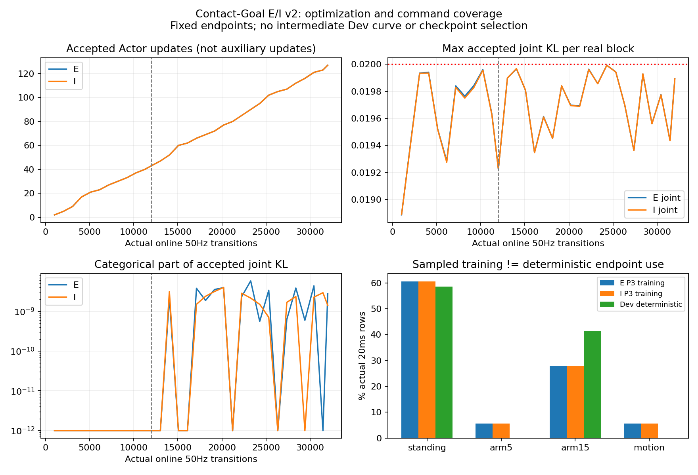

# E/I v2 完整结项：未超越 Goal-only 的预锁行为收益门

2026-11-17。Issue #66；固定终点、单训练seed、100个完整Dev回合。**两臂不晋级；本配方停止，不追加训练或读取sealed。**这是带归因缺格的负结果结项，不是所有归因实验均已通过。历史工程失败、旧结项及erratum全部保留。

## 一页结论

E/I各完成32,000条真实50Hz数据、127次Actor接受更新；完整Dev100/100，无记录硬物理中止。稳定/恢复保护通过，但E相对Goal-only的near/mid/stop-continue成本改善仅3.554%/−0.096%/0.580%，I几乎相同，均未达到至少两族下降10%的必要条件。按已签§7.4第三分支停止当前配方。

按当前Goal交集独立重算任务＋质量门：E=7/16、I=7/16、Goal-only=7/16父组合格；四个alternate-Goal回合是同父组分支，不增加独立分母。恢复自然、低滑移不能补造跟随成功。

训练中确实采到了motion：每臂P3为1,135条20ms记录/46次selector抽样；终点确定性Dev却只调用standing/arm15，E/I实际执行z逐值相同。已接受Actor提议中的categorical KL极小：E最大5.8233e−9、I最大3.9897e−9；这支持“高层命令分配的有效变化很小”，不证明唯一根因是探索、梯度冲突、reward或表示无效。

## 1. 合同、模型及实际数据流

依据[已批准v2正文](CONTACT_GOAL_EI_TRAIN_CONTRACT_V2_APPROVED.md)、[签署记录](CONTACT_GOAL_EI_V2_SIGNOFF_20261115.md)、[OR1已结项](CONTACT_GOAL_EI_V2_OR1_FINAL_RESULTS.md)、[正式预算修订](CONTACT_GOAL_EI_V2_FORMAL_BUDGET_AMENDMENT.md)。正文保留历史DRAFT字样，批准以签署及后续批准记录为准，不重写历史。

冻结原BFM F_R/B_R、embedding/前五层与normalizer/PD；适配原Actor最后一个ResidualBlock及输出层，接触经零初始化FiLM直接调制该层。高层只在standing/arm5/arm15/motion四个合法命令间选择，保持原256D norm16和真实上一z插值。不是自由256D搜索或完整基座FB重训。

E预测0.5/1/2s标准化24D真实后果；I预测16D后果编码并训练decoder/重建/variance-covariance辅助项。二者都通过当前因果预测上下文进入FiLM/selector，不把真实未来输入Actor；不是scalar-Q动作优化。训练为20ms Gaussian采样＋100ms command联合记账，selector最低0.5s dwell；P2 12k固定Goal查表、P3 20k联合PPO。OR1原五档Adam回溯、联合KL≤.02、std=.01与原实际动作映射不变。

Actor/selector只读本体、已执行action/z、理想力历史、已知腕安装、自身体位/里程计和当前公开FOLLOW/HOLD；当前伙伴真值/active只供训练V、reward及评价。无未来路径、停止时钟、任务ID、搜索答案或BC500隐藏特征。ideal-force/自体里程计仍为仿真假设。

训练runtime `08b9c96a4ea3d0c0007e840029ba6a30f3c858f0`；独立评价runtime `590aa54eb829b03f2fb76cf4f6bfa8ecf7489c52`。全部checkpoint/manifest/core/agent精确身份见[身份与主读数](contact_goal_v2_dev_first_results.json)。原BFM SHA `33f410c190877a1348dc3fafa3f0e97b277ad0251b39615ff98e5bd26369e361`；BC500冻结不变。E真实零学习参考在formal-E-03，不能把续跑E06的initial包当新鲜初始化。

## 2. 实际训练覆盖与优化

|臂|真实50Hz数据|完整回合/锁定父组|Actor接受/提议|辅助接受|接受joint KL中位/p95/max|categorical KL最大|
|---|---|---|---|---|---|---|
|E|32000|64/34|127/250|128|0.018452 / 0.019933 / 0.019993|5.8233e-09|
|I|32000|64/34|127/250|128|0.018448 / 0.019932 / 0.019992|3.9897e-09|

终点原core的literal记录另核：两臂完整覆盖全部44个spec索引0–43；各6,425条真实指令，实际FOLLOW→HOLD覆盖8父组、HOLD→FOLLOW覆盖7父组。不是由课程概率推算。

两臂各P2=12,000、P3=20,000，实际on-policy物理各128,000个5ms tick；native参考各4,650条不计PPO。64完整回合来自34个锁定父组的重复访问，不是64组独立证据，更不是多seed。oldlogprob最大误差均0。32个真实块，Actor提议与辅助表示更新分开计数。

|臂|P3 standing|arm5|arm15|motion|实际高层抽样 standing/arm5/arm15/motion|
|---|---|---|---|---|---|
|E|12125|1140|5600|1135|495/46/228/46|
|I|12125|1140|5600|1135|495/46/228/46|

完整source×请求×学习期×真实物理阶段×公开Goal数据量见[实际覆盖](contact_goal_v2_final_training_coverage.json)。阶段是环境/评价标签，不作为Actor答案输入。训练源为standing/arm-ready；不把本轮宣称为moving源或多行为族泛化。

图只含实际训练优化记录与固定终点比较；没有伪造中间节点Dev学习曲线。categorical对数图对≤0的浮点读数仅以1e−12作绘图下限，不是非零测量，也不修改原KL断言。

## 3. 预锁Dev主判据

16父组/20主回合×4方法＝80；4父组公开Goal反事实×4＝16；BC500仅4例FOLLOW历史参考；合计100。stop/continue同父组、alternate Goal不增加独立分母。K40/K80各8父组，6 arm-ready/10 standing；sealed未读，固定终点无Dev反选。

|族|Goal-only J|E J|I J|E改善%|E父组bootstrap95%改善区间|E/I/查表通过父组|
|---|---|---|---|---|---|---|
|near|0.637944|0.615269|0.615271|3.554|1.066/9.619|2/4; 2/4; 2/4|
|mid|1.124428|1.125509|1.125509|-0.096|-0.535/0.342|0/4; 0/4; 0/4|
|stop-continue|0.898178|0.892972|0.892973|0.580|-0.631/3.380|1/4; 1/4; 1/4|

J严格保留合同：真实阶段×当前公开Goal内RMS，非空阶段/Goal等权，兄弟父组内平均，同族父组等权。none/zero/recovery单列。bootstrap按4个独立父组重抽1000次，seed660304；小样本区间不变成统计充分性或收敛证据。逐条件原始RMS力/误差、J、K/source/Goal和失败项见[100条件表](CONTACT_GOAL_EI_V2_FINAL_TABLES.md)。

任务门按当时公开Goal判断：HOLD看公开固定腕目标，不用anchor误差判HOLD失败；FOLLOW才看anchor跟随及有效推进。混合Goal的原X推进公式只在连续FOLLOW交集适用，不要求HOLD随伙伴前进；停止保持另用8cm/6.5N。完全释放后不评价旧anchor/旧HOLD目标，恢复4秒独立报告。此表是按已签Goal-aware语义的事后核算，不是新成功定义。

## 4. 首个行为不足、质量与释放恢复

固定FOLLOW中距例case17：伙伴前进28.54cm、腕前进5.97cm，E误差12.328cm/力5.0646N；同条件Goal-only 12.341cm/5.0681N。不足已经发生在持续引导与保持，并非仅在release后。不能用自然收步解释释放前的接触失配，也不能因没有摔倒就叫跟随成功。

E/I主回合none/zero均4/4通过；各16个有真实载荷release回合均有合格同完整状态、同Goal的冻结原生恢复参考，恢复保护0失败。100回合没有记录硬中止；445个阶段×Goal窗口中，按已签“相对>25%且绝对>.03rad/.5rad/s”的逐关节门，对Goal-only未新增连续性退化。这里是同父组同窗的真实轨迹比较，不是同状态因果干预。

[分阶段XYZ/有符号误差/力/饱和/滑移/yaw表](CONTACT_GOAL_EI_V2_FINAL_STAGES.md)与[逐关节和逐窗统计](contact_goal_v2_final_stage_quality.json)保留q_PD与真实q/dq/力矩分列。q_PD目标跳变不是实际关节20ms转过同角度。loaded-slip法向阈值仍1e−6N，保留原着地瞬态/持久前后速度/其他接触语义及材料点位移，不调阈值降峰。

恢复时root/腕残余速度、加速度和根部路程单列；接触负担只在真实active窗计算，没有用释放后force=0稀释RMS。

## 5. 命令选择与I增量的证据分级

**已证实：** 两臂真实训练采到了四种命令；终点24匹配回合各11,630条50Hz控制只含standing6805/arm154825。E/I实际执行z最大差0，实际29D动作最大差0.000357300、q_PD最大差0.000133097rad。两模型身份不同且严格读回，不是重复加载同一checkpoint。四方法×四父组16个stop/continue完整前缀逐值通过。

同状态离线读数：在317个实际I访问的高层pre-draw状态，分别查询冻结E/I，所有先验argmax均未改变；raw-logit修正最大E=0.000324538、I=0.000326845，最小赢家margin仍约1.9454。范围是这些已暴露状态，不泛化为所有状态；不把相同状态的函数查询称物理反事实恢复。

**相容：** 本次selector的有效均值更新太小以改变初始菜单偏好；Gaussian更新占主要KL量级，低层小幅修正未带来中距/停止的共同收益。

**未证：** 是奖励目标、优势信用、梯度尺度、菜单候选的可用恢复域、联合更新约束还是有限覆盖主导了失败。不同闭环轨迹的动作差不能替代同状态首动作干预；没有把“探索采过”写成“采到过干净有效改善”，也没有把几乎零categorical KL直接宣称实现错误。

## 6. 表示分析与归因缺格

实际输入维度为B_R256、I在线上下文16、拼接272、当前deploy/public-Goal858、E在线上下文16。它们不是等维特征，但线性分类规则、C=1、折内标准化、最大1000迭代和祖先分组相同，无调参。普通当前输入已经可以较好预测此有限标签，不能把额外维度或线性probe解释为完整任务可控性。

probe的12组对应12个不同的实际source前缀SHA，stop/continue兄弟归同组；它们是锁定源父组，不等于12个独立训练seed或12种原生motion。

离线分析只拟合固定L2线性分类器，不更新E/I策略、BFM或表示。实际起始力门用Actor当时观测contact[6:9]×5N，不用下一physics tick选择起点；未来0.5/1s后果只用于标签。按真实祖先leave-one-group-out，stop兄弟不拆分。

### 0.5s有限“卸载且稳定”标签

实际3762行、12祖先；正1554/负2208。行数不是独立样本数。

|当前因果特征|held-out AUROC|父组bootstrap95%|
|---|---|---|
|B_R|0.9311|0.8851/0.9635|
|I_online_FI_context|0.9018|0.8518/0.9341|
|B_R_plus_I_context|0.9327|0.8896/0.9658|
|current_deploy_public_baseline|0.9609|0.9399/0.9840|
|E_online_outcome_context|0.8959|0.8457/0.9334|

I在线上下文相对最佳基线增量 -0.0592；95%区间 [-0.0986627212586518, -0.03196780149605728]。

### 1.0s有限“卸载且稳定”标签

实际3762行、12祖先；正1552/负2210。行数不是独立样本数。

|当前因果特征|held-out AUROC|父组bootstrap95%|
|---|---|---|
|B_R|0.9033|0.8564/0.9523|
|I_online_FI_context|0.8782|0.8298/0.9250|
|B_R_plus_I_context|0.9009|0.8544/0.9510|
|current_deploy_public_baseline|0.9093|0.8759/0.9512|
|E_online_outcome_context|0.8837|0.8311/0.9256|

I在线上下文相对最佳基线增量 -0.0311；95%区间 [-0.08199709921751222, 0.0022031815998711274]。

**特征语义限制必须保留：** 当前B_I Goal encoder输入为24D结果向量。把真实未来结果送给它再预测同一未来标签会泄漏。因此本次可执行的因果读数为在线F_I预测的16D上下文、B_R、二者拼接、同权限当前deploy/public-Goal基线、E的16D在线outcome上下文；这不是独立B_I(state)探针通过。未给不存在的当前状态B_I输入临时造schema，也未用未来编码补漂亮AUROC。

G14维持“未获得正向归因资格”。用于正向BI行为归因的4父组×2完整物理消融未执行：E/I已同时失败§7.1必要行为门，本轮按第三分支负结果结项，不为弥补失败追加物理。该缺格明确记UNMEASURED，不能叫“消融证明I无用”，也不把辅助probe补成行为胜出。

## 7. 错误、成本和可复现资产

原训练/评价失败均保留，详见[训练收尾](CONTACT_GOAL_EI_V2_FORMAL_TRAINING_COMPLETE.md)、[28k严格恢复](CONTACT_GOAL_EI_V2_FORMAL_NODE28_RESTORE.md)、[视频交付](CONTACT_GOAL_EI_V2_VIDEO_DELIVERY.md)。dense Jacobian索引数组修复保留原证据及逐值恢复，不放宽物理/概率比较。

本次后处理保留三次CPU失败：第一轮把辅助更新按Actor试验记录读取，命中缺少trials字段；按原auxiliary标记分开计数后再读；阶段表最初没有展开scene XML include，改为只读原MuJoCo模型核验29关节qpos地址；随后一处case变量名错误在I首例前退出，独立修复重读。均为读取/表生成错误，实际训练、模型、物理和判据未改变，失败时间全额入账。未覆盖旧失败目录。

入口原common-prefix自动检查漏列manifest真实`continue`族名。未重写既有评价：直接复核原完整控制轨迹16组逐值一致，补核PASS；不是假定前缀一致。旧报告原句保留并追加更正。

|账目|实际值|
|---|---|
|formal_stage_charged_job_s|40652.80810271413|
|formal_stage_hard_cap_s|56000|
|formal_stage_remaining_debit_s|15347.19189728587|
|new_measured_CPU_postprocessing_job_s|1457.7894046739675|
|new_unmetered_report_IO_conservative_debit_s|300|
|new_physics_ticks|0|
|new_policy_updates|0|
|formal_physics_counter_reserved|956642|
|formal_physics_cap|1100000|
|formal_output_bytes_current|7683060392|
|formal_output_GiB_current|7.155407585203648|
|formal_output_cap_GiB|10|
|prior_stage_debit_s|17055.595430435438|
|combined_prior_plus_formal_debit_s|57708.40353314957|
|project_conservative_upper_h|136.2929885646718|
|project_cap_h|240|
|ledger_sha256|31156f45414577b4f324cf909140967db212eafae93ac0889c4a6aa7819c2e19|
|ledger_status|NEGATIVE_CLOSEOUT_NO_NEW_STAGE|

成本按原正式stage账本：失败、冷恢复、物理参考分支、IO、评价、视频和CPU后处理分别记。训练统计64000条不包括重建/恢复验证/原生参考；100Dev不当PPO样本。项目累计同时保留实际stage与继承阶段的保守重复扣费上界，不把该上界冒称去重实际工时。完整原始ledger与SHA由阶段私有目录归档，数值摘要在[最终机器读数](contact_goal_v2_final_results.json)。

三条真实qpos 1×视频已在Yi指定Mac目录`compliance-bfm-diagnostics/videos/ei-v2-dev-20261117`，完整前缀/任务/4s恢复，SHA和完整解码已核验。来源/四格含义见[视频交付](CONTACT_GOAL_EI_V2_VIDEO_DELIVERY.md)。

## 8. 唯一后续建议与停止状态

本轮停止当前E/I v2配方；不追加seed、Student、自由latent搜索或更多BI训练。若下一阶段获批，优先只验证“selector是否能把已有有利采样保留为状态依赖均值选择”：用本轮真实P3命令/GAE/接受提议做同状态收益与logit变化的匹配诊断，再决定是否单独修订高/低层信用和更新尺度。先不以加大训练量、换reward或扩大菜单代替该证据。此为建议，没有自动启动。

本结项不否定BFM可转向/行走、既有有限域Teacher→Student成果或未来Interaction FB方向；它只否定本配方已获得预锁有价值反馈与I独立行为增量的主张。
