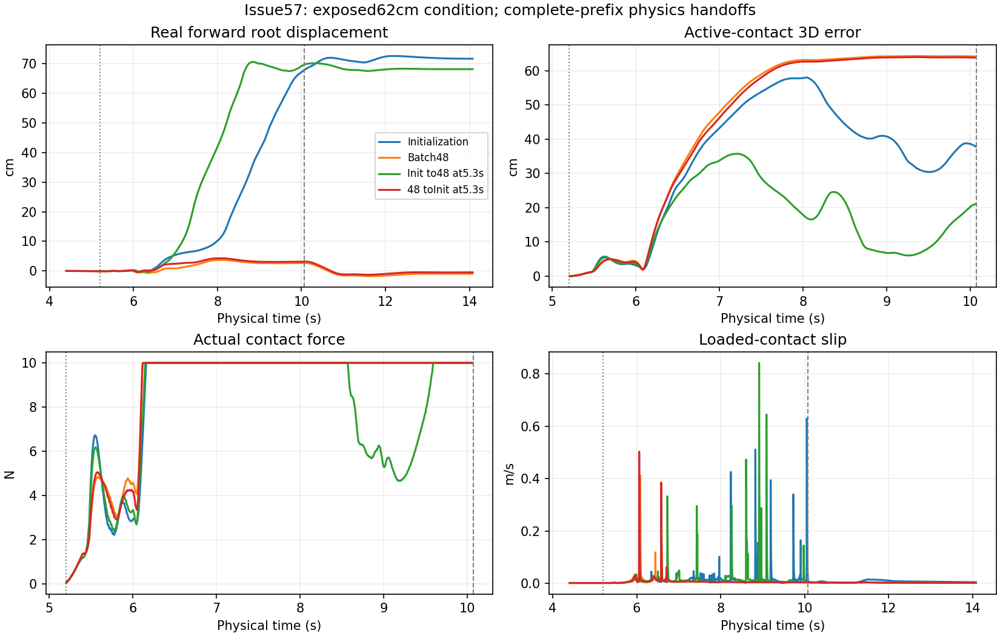

# Issue57：冻结闭环诊断与FB恢复验证

本轮有界测试已停止。D1完成；D2完整包/读回/继续采样通过，严格更新一致性未过，**不发放长跑资格**。
[Issue57](https://github.com/GaoE05/robot-research-bridge/issues/57)保留未关闭追踪D2，不自动追加实验。
事实起点8716f285f84d67ceadf1db9b9c85555fa5f314c5与获批合同不改；旧结项和erratum全部保留。

|工作包|实际结果|尚不能推出|
|---|---|---|
|[D1](D1_FROZEN_BATCH48_RESULTS.md)|六条确定性轨迹精确复现、24条真实接管；2812实际子步owner动作复算差0；接触前历史分叉和接管不对称|所有长距失去能力、唯一是梯度冲突或覆盖不足|
|[D2](D2_FB_STOP_RECOVERY_RESULTS.md)|198条实际踝roll越界完整归因；不可覆盖/原子完整包、六Adam等读回与采样精确一致|旧512更新可复原、新更新过程严格一致或可以长跑|

初始化5.3s状态切48，跟随误差38.26→19.59cm，但滑移峰.842m/s；
48自身5.3s状态切初始化仍50.78cm。前者不是通过全部质量保护的Teacher标签。
真实开发564输入独立对36864训练输入分块核查，保留距离/父组/原优势的解释边界。

三次恢复后的完整FB更新均有相同model/Adam差异，最大model绝对差2.384e−7；
确定性设置与原factory入口均未解决。不编造唯一原因，也不把微小差异当作FB不能学习。
[本轮验证erratum](D1_D2_VALIDATION_ERRATUM.md)记录全部失败和未关闭项。

图来自真实MuJoCo执行，虚线为onset/release；不是参考motion/q_PD动画。
释放后不计旧anchor跟随；没有裁剪接触负担或质量代价。

## 成本与身份

- 单RTX PRO5000 GPU0重作业串行，退出后0MiB/0%；共享BFM/PD/权重/main/其他任务不动。
- D1保守job计费866.95s，D2（含三次失败）1459.85s，准备/未单独计时操作预留900s；
  总3226.80s（0.896h）/12000s。
  旧入口按启动→最后自身产物加30s清理预留计费，**不冒称精确退出戳**；新入口有finish戳。
- D1真实受控49312个5ms tick/12328个50Hz控制，source/prefill另计。
- D2真实新采样2209 transition/7次完整工程agent.update；最初6次后事先登记一次构建入口对照扩为7，
  总job/输出封顶不变。物理重建不算新replay样本。
- 唯一输出约27.100GiB/48GiB；完全相同的新包payload核hash后hardlink去重，
  包路径、原字节、SHA和失败身份不丢失。logical/unique两口径都记账。
- 正式PPO/Student/1M/5M均0，无新模型晋级，BC500仍为基线。

|已执行runtime用途|完整commit|
|---|---|
|D1物理分支|c99d576f003f90acdaa05be2d851caacbb23a8b9|
|第一对FB验证|e0c5c6bfc071556252fb07b51df17436329d6699|
|确定性第二对|d990dffc7ca5aaca952205496fed025bbcdc2327|
|实际子步回放|d009c2be85fcab1dbe5a5fc637d76b2baa8e3cbf|
|factory重建对照|8ecd2116c85e1162d4ba25e69b065f2001e6333e|

发布HEAD与实际runtime分开。
[包/模型/Adam SHA](dual_track_diagnostic_artifacts/package-identities.json) ·
[成本账本](dual_track_diagnostic_artifacts/runtime-cost.json) ·
[完整性检查](dual_track_diagnostic_artifacts/checkpoint-checks.json) ·
[同状态五子步表](dual_track_diagnostic_artifacts/same-state-five-substeps.csv) ·
[实际子步观测回放](dual_track_diagnostic_artifacts/actual-five-substep-replay.csv) ·
[接管表](dual_track_diagnostic_artifacts/recovery.csv) ·
[后缀表](dual_track_diagnostic_artifacts/recovery-suffix.csv) ·
[开发覆盖](dual_track_diagnostic_artifacts/development-training-coverage-summary.json) ·
[旧198边界表](dual_track_diagnostic_artifacts/old-fb-boundaries.csv)。

## 下一单一干预建议（未启动）

D1：只检验已证实稳定source/precontact域的函数保持，其他科学变量固定；不直接整体改课程或锁身体。
D2：固定同一batch，拆六优化器子步骤定位首个不同张量，优先检查discriminator路径；
不再重复整次训练，不放宽概率/物理断言。

本轮无新MP4或真机；交付真实物理诊断图及完整私有轨迹，历史Mac视频不动。
不自动启动下一阶段。
