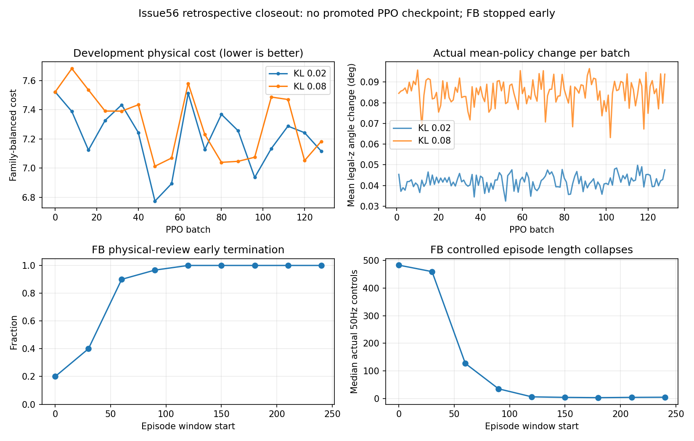

# Issue56：双轨正式研究结项

状态：本轮已停止并完成存档结项；无新模型晋级，无后续任务自动启动。
日期2026-11-10。公开文档与诊断源码commit区别于固定训练runtime
147b22b684b0c03a613559fa6d5e5881d380ab7f。

## 结论

1. 两个KL臂各完成98304真实高层决策，开发均选择初始化。
   接受更新和局部成本改善成立，但未取得符合预声明保护的共同物理收益。
   KL .08确实允许更大的实际均值改变，仍未解决共同收益；不把失败归为
   “actor完全没更新”，亦不声称所有更新尺度/探索都已排除。
2. 第48批有明确arm-ready局部收益。长距中位数恶化不能概括为普遍长距崩坏：
   六条中五条误差改善，仅一条standing/.22m/s显著变差。
   该条件起步首秒质量已有差异，主要额外误差在保持阶段；
   真实覆盖与固定点梯度已复算，但无法从存档确认其逐帧状态重叠或唯一病因。
3. FB接触扩展实际采集与完整更新已运行，最后完整块33792 transitions/512 updates；
   因后续大量接触前质量早停、有效任务经历持续萎缩，按用户新授权提前停止。
   不是完成1M终检，不证明整个FB方法无效。
4. 中途FB内存权重/优化器/replay未保存是确认的存盘缺陷，独立勘误。
   两组PPO最新末轮和全部历史模型完好，BC500继续为冻结基线。
5. 当前没有进入多接触/多技能Student共同训练；原生搜索→可靠神经Teacher→
   受限Student的新完整路线仍有缺环。历史有限Teacher→Student正结果保持成立。

## PPO完整对照与曲线

|臂|真实高层决策|接受actor step总数|最低数值成本：batch / score|按开发保护选中batch|
|---|---:|---:|---|---:|
|expert-kl002|98304|213|48 / 6.7746|0|
|expert-kl008|98304|255|48 / 7.0134|0|

两臂各128批，std .008、同起点/课程/物理/奖励/预算，仅KL合同不同。
另有前期一次工程高层smoke768决策，独立记账，不冒称正式PPO收益或隐去成本。
开发30父组/36真实子回合，每8批独立进程；0至128共17节点。
封存60父组只评价各自选中的初始化，不能计新学习成功或按封存反选其他批次。
高层actor/critic分别更新；原概率、Adam回滚与评价RNG合同未放宽。
二者不是两个独立训练seed，不能由单配对宣称总体统计优劣。

[逐批数据](dual_track_formal_artifacts/high_learning_curves.csv)；
[batch48分阶段、覆盖和梯度归因](DUAL_TRACK_BATCH48_RESULTS.md)。
滑移/偏航保护仍按批准定义；不存在“所有旧数值不能变化”的额外门槛。

## FB实测与提前停止

原生源前缀由原冻结BFM真实生成，97D接触/伙伴扩展的独立副本执行实际控制；
无I/C0/T30在线动作来源，无手写force→skill规则。fresh replay、六Adam、
Identity contact辅助reward normalizer。16update/1024新transition，
首1024 warmup计入真实样本但不更新，33792对应512更新。
编译热身后16完整更新约5.1s，但采集含reset/失败成本持续升高，
不能将纯更新时间或早期采样率外推为1M可承诺耗时。
最后未完成采样块增量未知，实际wall已计入。

停止job2605.98s；记录244回合/198个physics_review，后段多个窗口100%早停，
不等于198次摔倒。step0/250k/1M中只有step0保存。
[完整停止表、SHA与成本](DUAL_TRACK_FB_EARLY_STOP.md)；
[独立保存勘误](DUAL_TRACK_FB_CHECKPOINT_ERRATUM.md)。
当前没有可评估的FB训练末轮，不能报告其独立任务收益、最终reward-prompt能力
或旧能力保持。相应格子缺失是本轮结论的一部分，不用初始化冒充训练模型。

## 四格能力表

|基座|特权Teacher|受限观测Student|
|---|---|---|
|冻结原BFM|KL .02/.08完整PPO；均选初始化，无新共同收益|历史ideal-force BC500保留；未新增Teacher迁移/Student RL|
|独立可训练FB副本|97D版本已采集33792完整落盘样本、512完整更新后早停；训练末轮未存，无独立物理收益结论|未实现/未训练；不能将特权字段清零冒称Student|

这些不是等成本PPO-vs-FB方法胜负表。FB仍有FB/CPR目标和contact辅助目标，
动作层与高层PPO不同；共同物理评价和折扣对齐不消除这些差别。

## 身份、成本与完整性

BC500 a6688f292d8a212bebed4384532026ce3f703269165cd74afd0d0d635d4d4e1e；
原BFM33f410c190877a1348dc3fafa3f0e97b277ad0251b39615ff98e5bd26369e361。
两组末轮SHA见停止记录；全部候选、初始、末轮、失败及原wrapper退出记录保留。
权重、原始trajectory和replay不进Git。

包括全部正式/失败/工程/CPU分析及旧carry和准备预留，
当前已登记累计约16.056job小时，低于240h授权上限。
存档CPU分析01/02/03均计费，最后一次约24.15s、无GPU/物理/RL新增。
原运行源码未改，main/共享BFM/PD/其他用户任务未改。
本任务队列及GPU进程均退出；当前只整理既有结果，不自动新训。

## 下一项最有证据的决策

- 冻结线：先针对已暴露standing较快引导的启动→持续→保持状态链，
  做完整状态记录的同模型复核；不能凭族中位数就增加长距比重或做梯度手术。
- FB线：先在新独立runtime补可靠的早停保存/读回，再定位质量边界触发
  与真实关节状态、actor各目标更新的关系，不原样重启1M或擅自放宽边界。
- 受限Student：未得到新可靠Teacher之前，不为凑齐四格追加训练。
- 以上为下一轮建议，不是启动授权；本轮完成即停。
