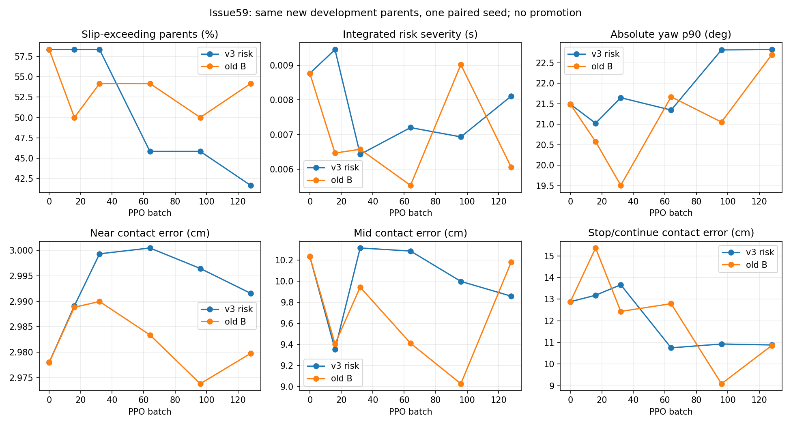

# Issue59 — F-RL-v3 结项：部分风险改善，未晋级

核对日期：2026-11-11。128批正式训练、旧B六节点同新dev配对、v3两节点旧条件回归全部完成。GPU任务已结束。BC500仍为冻结基线；不自动启动下一轮、Student或FB。

**结论：本seed的风险事件惩罚改变了取舍，但没有取得相对旧B的共同质量优势。** 相对初始化，v3-32严重度下降26.65%；v3-128超限父组14/24→10/24（下降28.57%），严重度仅下降7.49%。相对同预算旧B128，v3超限父组13/24→10/24，但严重度上升33.85%，且旧停止回归退化。不能把相对初始化的PPO收益全部归给新增惩罚。

[锁定协议](FRL_V3_RISK_PROTOCOL.md) · [包一完整结果](FRL_V3_P1_RESULTS.md) · [资格](FRL_V3_QUALIFICATION_RESULTS.md) · [erratum](FRL_V3_ERRATUM.md) · [聚合数据/身份/账本](frl_v3_results.json) · [逐条件及分阶段数字](frl_v3_condition_results.json) · [训练曲线数据](frl_v3_learning_curve.json) · [Issue59](https://github.com/GaoE05/robot-research-bridge/issues/59)

## 评价口径与选模

新开发32父组、40真实子回合；near/mid/stop各8父组，zero/none各4，stop/continue整父组合并，主绝对坐标分母24。下面误差/力为各族接触窗3D误差及实际力RMS的子回合中位数，stop含16子回合；不是把未接触/释放force=0混入接触负担。绝对严重度为每20ms风险h的时长积分，按父组及三族等权汇总；这与训练中不乘dt的事件reward单位不同。完整释放阶段仍纳入原滑移/yaw质量定义，不删不利时段。

原相对风控仍选iteration0；预登记严重度优先科学候选为iteration32，不是晋级模型。128为规定末轮，不按其超限比例重新改选。全部已训练节点仍未过旧质量门，yaw尾部仍>20°。新dev用于开发而非新封存；旧32仅回归，未读旧封存，也未用回归重新选模。每节点两臂parent/child/condition及source_state_sha逐值配对一致，数据见汇总脚本。

## 新开发完整曲线

| 批次 | v3超限父组 | 旧B超限父组 | v3严重度(s) | 旧B严重度(s) | v3 yaw p90 / max(°) | 旧B yaw p90 / max(°) |
|---|---:|---:|---:|---:|---:|---:|
| 0 | 14/24 | 14/24 | 0.008765 | 0.008765 | 21.49 / 25.01 | 21.49 / 25.01 |
| 16 | 14/24 | 12/24 | 0.009449 | 0.006466 | 21.02 / 24.29 | 20.58 / 22.48 |
| 32 | 14/24 | 13/24 | 0.006429 | 0.006576 | 21.65 / 25.55 | 19.51 / 22.94 |
| 64 | 11/24 | 13/24 | 0.007200 | 0.005535 | 21.35 / 24.31 | 21.67 / 28.07 |
| 96 | 11/24 | 12/24 | 0.006932 | 0.009016 | 22.81 / 25.74 | 21.05 / 29.07 |
| 128 | 10/24 | 13/24 | 0.008109 | 0.006058 | 22.82 / 24.90 | 22.70 / 24.99 |

图中纵轴为实测物理量；near差异很小，不能因缩放后视觉幅度大就宣称大收益。0/16/32/64/96/128均为固定节点，不是只展示最佳。

## 接触误差 / 力（cm / N）

| 模型 | near | mid | stop/continue |
|---|---:|---:|---:|
| 初始化 | 2.978 / 2.569 | 10.232 / 7.638 | 12.882 / 8.065 |
| v3科学候选32 | 2.999 / 2.586 | 10.313 / 7.469 | 13.663 / 8.120 |
| 旧B32 | 2.990 / 2.579 | 9.942 / 7.360 | 12.432 / 7.976 |
| v3末轮128 | 2.992 / 2.579 | 9.858 / 7.534 | 10.884 / 7.748 |
| 旧B128 | 2.980 / 2.572 | 10.180 / 7.577 | 10.859 / 7.605 |

v3末轮对初始化：near基本不变，mid小幅改善，stop误差12.882→10.884cm、力8.065→7.748N。但与旧B128相比，mid误差仅改善约0.32cm；stop误差几乎相同、力更高0.143N。科学候选32的严重度仅比旧B32低2.24%，超限父组和yaw却更差。单配对seed不能证明稳定方法优势。

v3-128/旧B128的移动窗腕X进度中位数：near7.51/7.61cm、mid32.04/31.88cm、stop17.48/18.36cm。通过既定推进守卫，不能简单解释成完全不动换低滑移；但停止/持续时序与尾部仍有代价。v3 mid/stop接触饱和比例中位数23.06%/45.35%，旧B为24.18%/37.26%。

### 严重度与超限数量分歧的具体负例

末轮mid父组`5c67db5a…`：旧B→v3严重度.000474→.024574s，峰值.519→.951m/s，末yaw18.50→22.52°；mid父组`12c3401f…`严重度.026229→.042835s。stop父组`97ff10c4…`严重度.013784→.027756s，峰值.962→1.223m/s。这些足以说明少数更重尾部不能被较少超限父组掩盖。完整ID与各阶段见逐条件数据。

## 旧32父组回归：保留负结果，不反选

| 节点 | 条件族 | v3误差/力 | 旧B误差/力 |
|---|---|---:|---:|
| 64 | near | 9.344 / 6.487 | 9.001 / 6.478 |
| 64 | mid | 7.846 / 6.279 | 7.252 / 5.723 |
| 64 | stop | 11.115 / 7.702 | 8.927 / 6.218 |
| 128 | near | 9.402 / 6.469 | 8.476 / 6.471 |
| 128 | mid | 7.617 / 6.224 | 7.447 / 5.874 |
| 128 | stop | 11.977 / 8.108 | 9.063 / 7.036 |

尤其旧stop128：v3为11.977cm/8.108N，旧B为9.063cm/7.036N；这不是可以省略的共同收益。旧reg128绝对yaw max26.36°，仍未过。新dev与旧reg任务参数不同，不能把两套near绝对数值当同条件变化。

## 包一与正确性结论

- 10父组/32完整状态/280实际分支；32归档参考续跑的13440物理tick及3360控制逐值复现。有限有效非入口分支只在2状态/2父组建立，不能外推广域恢复。
- 8条历史样本：GAE与有限2.1s反事实回报符号5/8一致，历史概率改变与该回报3/8一致；不是完整期望优势，不能据此判critic硬错误。严格干净成功/打滑成功匹配对为0，不能宣称包一已证明新reward更优。
- 超限峰值法向力均>10N；79个超限5ms tick中69个在积分后消解，10个仍超。当前风险包括带载接触瞬态，不能直接将超限减少称为持续支撑滑移减少；本轮未改变法向力阈值。
- λ0更新与旧路径模型/Adam逐值一致，并复现归档B65；λ=.33真实Task.step检查420tick物理及非reward合同一致，105控制中103零事件reward不变，2个仅规定项变。旧B可作固定对照。
- P1两次工程失败（路径拼接、NumPy bool汇总）与完整数据恢复均保留；原资格80更新重复计数已独立勘误。正式01在首更新前停止补实际正事件验证，0新增RL；正式02完整恢复后运行。不得覆盖这些记录。

## 实际训练、模型和成本

- 正式新增98,304高层决策、489,640次50Hz控制、1,958,560个5ms物理tick；998完整回合，无真实物理边界终止。这里只计训练rollout，不含源前缀/资格/独立评价。
- 完整回合near285/mid310/stop207/zero98/none98；实际决策及阶段覆盖见JSON，未把课程概率当实际经历。
- 接受actor step 261，critic step 2304，回滚候选368；LP最大.0001220703<.0003，接受jointKL最大.0199378<.02。
- 末批D_pre均值.017375、p95 .026253，目标.01不是始终严格满足的硬约束；原固定对偶规则与系数上限均未改。不能用critic EV或reward上升替代物理结论。
- 正式runtime `85af4353747bd000b50b9fbf06236e23c8d5ef4f`；正事件资格/有限排程 `cc1ddf6ee2fd4e5b7b02d7a3b791574f46396150`。报告代码不修改上述runtime。
- BFM `33f410c190877a1348dc3fafa3f0e97b277ad0251b39615ff98e5bd26369e361`；BC500 `a6688f292d8a212bebed4384532026ce3f703269165cd74afd0d0d635d4d4e1e`。
- v3-0 checkpoint SHA `2282fcf6a5fdf8156b79218ec3ea22944dc807ba747e51e859fe59b6c532f012`；项目experiments下 `frl-v3-risk-20261111/runs/formal-v3-lambda033-01/candidate-0.pt`。
- v3-32 checkpoint SHA `ce9bec931c8e8a27085bdf4c6471a07551fa23b1bf5846b7ad73c22b331713e5`；项目experiments下 `frl-v3-risk-20261111/runs/formal-v3-lambda033-02/candidate-32.pt`。
- v3-128 checkpoint SHA `f6bf786cec47fb10ba362522680107071c74912530f183546f48c29757d52336`；项目experiments下 `frl-v3-risk-20261111/runs/formal-v3-lambda033-02/candidate-128.pt`。

P2所有监督job sidecar实测26012.06s=7.2256h（正式训练18610.39s，包含其开发评价；外部评价另计，不能再次重复加内部dev wall）。加1200s准备reserve及120s CPU结项保守reserve，合计7.5923h<24h。P1监督失败/完成物理实测1139.55s，另81.63s CPU和1800s准备reserve，约.8392h；完整失败账本见JSON。reserve不是实测。CPU汇总首版使用Python3.11的file_digest遇到环境3.10不兼容，随后改流式hash，未改训练/评价结果；本地只读检查脚本字段错误亦未影响科学资产，均计入结项reserve。

runs/jobs/prep归档约16.70GiB（含完整快照、模型、全部真实轨迹与失败；本指令P2未规定新增输出硬顶），不上传这些大资产；公开仅源码、分项汇总、曲线与哈希。逐条件JSON含标量/分阶段指标而非原始qpos。所有raw证据仍在独立stage，未清理旧资产。本次收尾没有新增物理、训练或视频渲染；真实轨迹已保存，不以预测分支冒充视频。

## 证据等级与下一决策

**已证实**：有限同状态有效方向存在；新事件项正确接入；本seed部分超限指标改善但与严重度、yaw、旧停止表现存在取舍。**相容但未证实**：事件惩罚可能改变接触/支撑时序，使较少条件超限而少数更重，或与跟随奖励冲突。尚不能把它写成唯一根因，也没有多seed总体胜出结论。

下一项最有判别力的建议：优先用已存档上述尾部父组，核对带载瞬态/持续支撑滑移的逐tick时序与reward贡献，确定新增惩罚实际在压制哪类动作；不先扫λ、不放宽门、不自动再训。该建议尚未启动。BC500维持基线，阶段已完成并停止。
