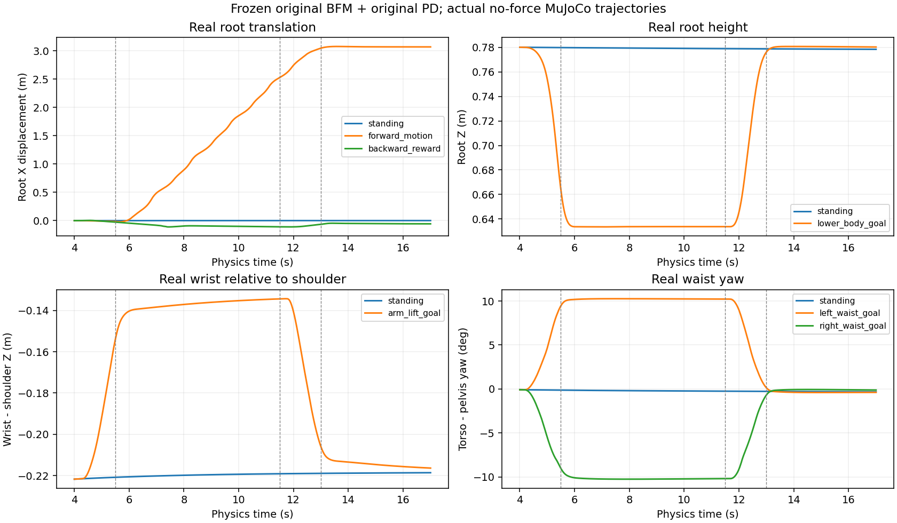

# 包二：原冻结 BFM 无接触能力盘点

12个预固定候选全部真实执行完毕，没有触发原物理边界；这不等于12个任务都成功。
外部Tether从始至终disabled，逐5ms实际外力均为0；地面/足部接触正常存在。
未调用I/C0/T30/S0高层actor，无训练、无PD/基座修改。

## 执行来源与边界

每回合由原BFM真实standing执行到4.0s，保留身体/solver、观测/action/last-z与历史；
随后原256D合法z经原BFM、原PD实际执行。目标q只在私人MjData中形成goal输入，
从未写入真实模拟器qpos。3–4s真实源前缀与全部5ms身体/接触、50Hz动作/q_PD、
100ms目标z都保存在每条 `*-actual.json.gz`；不是reference动画。

固定4.0–5.5s进入、5.5–11.5s持续、11.5–13.0s回standing、13.0–17.0s恢复。
12条均完整13s测试段，另有原生源前缀；不是接触释放实验。
保持原0.02rad关节边界、高度/倾角/接地断言，未调整任何容差。

来源分别是：原standing z；既有M10 `task` straight/left/right motion序列；
原goal接口的±15°腰部与肩pitch−.6rad目标；既有neutral-arm下沉goal（源dance1_subject2/frame1690）；
goal_arm5；原reward API的正/负.15m/s提示；−.15m/s root速度goal。
M10 task motion是历史上经手臂参考替换/straight腰均值调整后再调用原B生成的资产，
**不是声称未经修改的原始motion，更不是已学好的接触反馈策略**。
原始/资产SHA见[身份表](fb_native_bias_artifacts/identities.json)，
生成/执行代码见[native_inventory.py](native_inventory.py)。

## 三分判读（限定本初态、幅度、持续时间和有限候选）

|能力|三分判读|真实证据及边界|
|---|---|---|
|站立/回standing|找到可靠原生行为|13s root水平平移约1.4mm，slip峰.00169m/s；存在小幅整体yaw漂移，不称完全不动|
|前进＋停止|有行为，但当前prompt/z调用未找到满足既有完整质量参考的版本|motion真实前进3.068m；持续vx .424m/s；恢复段平均平面速度向量模约.0082m/s。能走能停，但slip峰.811m/s>.45参考，持续末pelvis −22.53°，不称合格低速接触来源|
|后向移动|当前资产与搜索范围内未找到可靠持续后退|reward候选持续vx −.0138m/s、总后移5.66cm，slip峰.723m/s；速度goal仅−.0010m/s。不是已实现−.15m/s后走，更不说明基座不可能|
|左右上身小转腰|找到可靠原生行为|同原生goal接口：持续末waist相对pelvis +10.23°/−10.21°，slip峰.00271/.00402m/s，随后回中性|
|左右迈步转向|有行为，但当前调用未找到可靠双向版本|right motion持续末pelvis −20.01°、有推进；left motion末pelvis −7.42°，不能因名字left就当左转。双侧motion均有>.45m/s滑移峰；腰转不能替代整机迈步转身|
|降低高度＋恢复|找到可靠原生行为|持续平均root高度.6343m，standing .7795m；回standing恢复，未越界，slip峰.00651m/s|
|手臂准备/抬升＋保持|找到可靠原生行为|arm5持续末腕相对肩前移比standing多3.34cm；抬升goal使腕相对肩高8.48cm，保持并恢复，slip峰.00225m/s|

“.45m/s”只沿用既有质量参考，未把超出的motion改判为全质量通过。
前进/停止的**实际能力存在**与它是否是合格低速接触来源分开；
第三类不允许写成“BFM不会后走”。“可靠”仅指这里实际进入/维持/恢复的有限原生实例，
不是多seed、跨初态或接触负载泛化资格。

standing自身持续末torso/pelvis为−8.59/−8.33°；
左右腰goal持续末torso为+3.82/−19.10°，相对匹配standing分别+12.41/−10.52°。
因此同时给出torso、pelvis、waist相对值，避免把standing偏航漂移当成转向能力。

## 每候选质量/失败表

所有候选均保留，目标未达成也不删；没有摔倒/关节边界早停不等于目标完成。
以下q_PD跳变是20ms目标，实际q变化是5ms物理变化，不能相互等同。

|候选|持续vx m/s|总root X m|slip峰 / p95 m/s|最小实际关节余量rad|最大q_PD步变°|最大实际q 5ms步变°|
|---|---:|---:|---:|---:|---:|---:|
|standing|0.0001|0.0008|0.0017 / 0.0016|0.1808|0.01|0.00|
|forward_motion|0.4241|3.0676|0.8112 / 0.0234|0.0227|60.90|3.85|
|left_motion|0.0082|0.0726|0.5101 / 0.0180|0.0895|23.31|1.47|
|right_motion|0.1638|1.1086|0.6378 / 0.0215|0.1237|47.66|1.28|
|left_waist_goal|-0.0001|0.0004|0.0027 / 0.0022|0.1550|0.59|0.13|
|right_waist_goal|0.0002|0.0003|0.0040 / 0.0033|0.1692|0.48|0.11|
|lower_body_goal|-0.0013|0.0002|0.0065 / 0.0059|0.0747|1.40|0.40|
|arm_ready_goal|-0.0001|0.0007|0.0017 / 0.0017|0.1814|0.28|0.07|
|arm_lift_goal|-0.0007|0.0002|0.0023 / 0.0019|0.1466|0.93|0.18|
|backward_reward|-0.0138|-0.0566|0.7231 / 0.0161|0.1122|20.58|1.82|
|forward_reward|-0.0023|0.0008|0.0122 / 0.0102|0.1811|2.03|0.42|
|backward_velocity_goal|-0.0010|0.0005|0.0024 / 0.0020|0.1554|0.91|0.17|

逐阶段支持计数、足部路程、实际q全关节活动幅度与最小余量关节、qdot、身体高度、
持续/恢复速度均见[inventory-summary.json](fb_native_bias_artifacts/inventory-summary.json)。
有载荷slip沿用实际地面法向力>1e−6N的原口径，不通过抬高载荷阈值去掉峰值。

图来自实际qpos/身体位置，虚线为进入结束、撤销开始、恢复开始；不是目标姿态/q_PD动画。
未中心化reward前进候选没有持续前进，说明“z已分化”与“能实现目标”不同。
本包不执行中心化候选，也没有重新搜索参数找补。

实际runtime `aa62fe541037bb6a59f453fe4b9c366e10977523`，
受监督job墙钟 **316.03s**，其中实际study197.65s；
31200个受控5ms tick＋7200 reset/prefill＋2400原生源suffix tick（backend自检另计成本）。
原BFM SHA `33f410c190877a1348dc3fafa3f0e97b277ad0251b39615ff98e5bd26369e361`；
原权重/normalizer冻结核查通过。没有新Expert/Student或额外技能训练。
