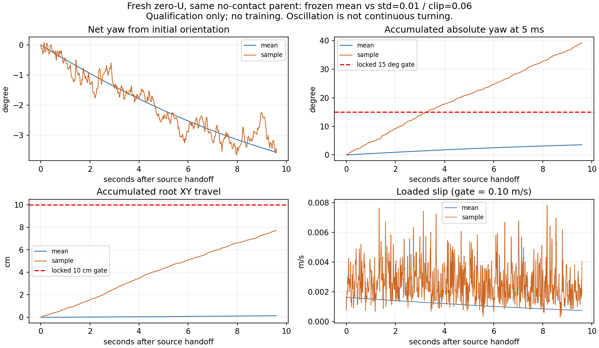

# R2 E/I v1.0：已获批准，冻结均值通过；实际采样资格暂停

2026-11-14。**Yi已明确批准** [R2-EI-TRAIN-CONTRACT v1.0](R2_EI_TRAIN_CONTRACT_V1.md)。正文原DRAFT/待签字样由用户直接签署覆盖，历史草案不改。批准已登记Issue63 comment6872314412、Master18 comment6872316817。

本次没有启动Q、Actor/U、B_I/F_I训练。按合同§1/§3/§10，在实际探索采样的第一个none父组触发预锁保护门后停止。**这是新配方入口资格失败，不是E/I学习失败；无真实硬越界，也不是持续转圈。** 不改reward、std、clip、资格口径，不读Dev/Sealed，不跳过失败父组继续。

## 1. 已执行及共同身份

- 原基座SHA256 `33f410c190877a1348dc3fafa3f0e97b277ad0251b39615ff98e5bd26369e361`；Actor/PD/normalizer/物理不变。
- 完整U以预锁seed636410新建，隐藏层同参数，最后层权重/偏置零。未加载任何A128/B19/Return学习权重。原Actor尾部复制原基座；所有Adam为空，Q共同−softplus，Goal增量零。
- E普通GoalEncoder与I B_I初始参数逐值相同、输出32D；额外I分支不消耗训练采样的随机流。公开Goal仍standing/hold的固定模板，不是伙伴真值。
- [入口锁](r2_ei_approved_entry_lock.json) SHA256 `53fa302936824c339709ba2c894bd0cad3a4683a619cc050bc4f834af284bdbf`，开跑前固定10个train父组/12回合；stop/continue不算两个独立父组。Dev/Sealed未运行。
- 原六回合的新鲜零U与旧零U归档：**条件、完整physics、完整controls均逐值相同6/6**。12回合含10个不同真实source指纹，不以不同seed/生成器哈希声称统计独立。
- E/I每个实际执行状态上匹配网络张量、原动作、合法z、Q输入和Q输出；采样恢复同RNG后逐值一致，只有一份std=.01/clip=.06 Gaussian噪声。均值6090个控制步、采样480个控制步通过；同一个物理执行器执行共同动作，不虚报另跑了两套独立物理回合。
- 当前/未来特权字段扰动不影响deploy输入与U；采样runtime另逐步核验实际Actor输出不变。Q可有训练特权，公开prompt固定不取当前隐藏状态。

函数摘要（不是新训练checkpoint文件SHA）：

|对象|SHA256 tree digest|
|---|---|
|原Actor|99fa786fbfd5f5f291f0b7db167b4d32ef24087b790511d4e73646e686491364|
|原Actor tail副本|05f449160edccfc8cc6393227897f9135e2d8fe5d2557052daee74c02e29ff29|
|normalizer|ef5a75e784ca31d85f12190b374fa73eccbe69f5081f38e645726f967b495883|
|全新U|21b4ebf82cde68f6f119d78ff9e7d93d7bc303c9134e51a11bb9d96a00899a54|
|共同GoalEncoder/BI|87737f152b3aa7cbb0140fe84dc476f7538a9c86e3d170f65b92b57cb347d429|
|完整初始E|673e234c86e414742cf7c2231001a951049e5457890bb2a3f6e7622dca48559a|
|完整初始I|03efa2f9539f87c35db7a9a54bf459309388755c2c66cc5b3fea64e4e95a91ea|

## 2. 冻结均值与保持参考

10父组/12回合全部通过新初始化保护；全部真实关节硬界/失支撑0。近/中/停止仍有原生站立跟随不足，**没有改判任务成功**。

[逐父组参考/源/时间/数据哈希](r2_ei_retention_reference_lock.json)与[完整均值证据](r2_ei_entry/mean-reference.json)。只锁实际mean后继作为参考；采样轨迹不自动成为原Actor合格模仿标签。恢复指相同完整历史下已经执行的后继，不来自另一个Teacher的伪历史。

公式标定 `eps_rms=.015rad`、`eps_p95=.030rad`，均由原生20ms变化及批准clamp得到下限。这个结果不是“任何.015rad改动都物理安全”的证明；完整物理sentinel仍必要。参考来源是当前standing＋有界原生arm脉冲源，不宣称覆盖全部运动库。

## 3. 首个采样父组：失败到底是什么

预固定none父组 `ede27bac003dfc662e814e958c1bd0f3e2b2c487616c1055634e9b3b7108ea79`；source指纹 `c810ec170b493382814a9c53ae4f4254bfb12980ba3a73755633b6ba4d80fe44`。mean/sample首BFM观测、q/qdot、时间、执行z及完整source身份相同。此回合**始终无外力**。

|量|冻结mean|实际sample .01/.06|合同判读|
|---|---:|---:|---|
|5ms累计yaw绝对变化|3.568°|39.323°|sample超过15°|
|首尾净yaw变化|−3.568°|−3.529°|描述量，不能替代原门|
|yaw最大—最小范围|3.568°|3.730°|不是连续转圈|
|全回合root平面路程|0.141cm|7.726cm|均≤10cm|
|root净位移|0.097cm|0.225cm|往返路程不等于持续漂移|
|loaded-slip峰|.001653m/s|.007856m/s|均≤.10m/s|
|loaded-slip p95|.001591m/s|.005065m/s|描述量|
|真实关节越界/无支撑tick|0/0|0/0|无硬物理失败|
|实际外力|0|0|不是接触任务收益|
|20ms q_PD单关节跳变峰|.00528°|7.164°|目标，不是实际关节变化|
|5ms实际q单关节跳变峰|.00138°|.1831°|与q_PD分别记录|

初始均值与实际采样的差别是批准的一次29D噪声。sample的5ms yaw方向变化符号反转268次，p95绝对角速度10.628°/s；这支持反复小幅往返摆动解释，**不支持“又出现A128那样持续转三圈”**。源、权重和初始物理一致，配对干预支持该采样合同引入此摆动；只有一个预锁采样父组，不外推所有随机流。

末4s（9.9–13.9s）累计yaw变化mean1.180°、sample16.107°，也超过15°；sample root路程2.920cm，小于mean.0683cm＋10cm，slip峰.007856。**这个none回合从未有接触，末4s是预定义恢复时间窗，不是真实“解除接触后的恢复”证据。** 原始结果字段`frozen_recovery_reference_failed`在此指sample末窗未过；不能理解为已合格mean参考失败。原始标签不覆盖，主决定性失败是全回合none门。

按20ms/100ms抽样重算累计yaw为34.725°/17.607°。这些只是对既有数据的语义诊断，**不是修改门的采样频率或补做通过判定**；有效判据仍为运行前锁定的5ms总变差 `sum(abs(diff(unwrap(yaw))))`。没有移除小变化、加滤波或改容差。

## 4. 证据分级与停止点

**已证实：** 新鲜零U均值在本次10父组初始化/保持门通过；E/I初始函数/动作一致；冻结sample第一none回合违反预注册累计yaw门，无硬关节/支撑失败。Q/Actor/BI从未更新。

**相容且有配对支持：** 20ms独立动作噪声引起反复小幅身体摆动，从而显著增加5ms累计yaw与root路程。不能用净偏转很小忽略这类运动，也不能把累计39°误报成最终转39°。

**未证：** 当前噪声能否在接触中提供有效探索、是否可经RL学会抑制摆动、Q warm-up能否过门、E/I学习优劣、BI增量、32k/臂和完整恢复存储可行性，全部未执行/未证。剩余5个采样回合按停止条款不跑，不找新seed。

按合同§1/§3/§10暂停两臂。未改std/clip/reward/PD/cap/物理或科学阈值；未尝试Envelope/平滑/降噪；未启动Q-only、Actor/U或probe。该停止不改Issue62/旧A128/Return/D1及所有历史结论。

## 5. 已写工程、未取得的资格

新鲜初始化/逐值对齐/权限/资格执行器已版本化。CPU无损checkpoint原型通过四轮小型真实Adam更新的跨进程逐值读回、任意轮次0/2/1/3读取与损坏拒绝；这是合成小网络存储测试，**不是E/I训练，也不是完整MuJoCo checkpoint资格**。

四块真实E/I Q-only、完整物理恢复、增长投影、Q排序、SF标定、正式Actor循环和五方Dev均缺格。未发车的Q-only/增量存盘草稿完整保存在独立私有prep目录，哈希见成本表；未把未验证训练入口合并为可运行正式管线。旧checkpoint恢复行为没有改动。

## 6. 实际成本与身份

|项目|job秒|physics ticks|结果|
|---|---:|---:|---|
|12回合冻结均值|1047.225|36441|通过|
|首个实际采样回合|208.639|4241|保护门失败，正常存完退出|
|准备/CPU单元/审计/归档保守上计|1200|0|不是GPU实测时间|
|本次新增合计|2455.864|40682|无训练|
|继承R2历史|3088.840|独立旧账|不重置|
|R2累计|5544.704 / 57600|—|约1.540h / 16h|

输出两R2运行目录实测约.814GiB/12GiB（公开小报告另计微量）；新任务显式计入项目240h，不与D1账重复。冷启动、原生prefix/reset、IO及失败均在两个supervisor wall中，子进程不重复加时。完整sidecar/实际数据保留，公开[成本/状态清单](r2_ei_entry/cost-and-status.json)。无训练transition，Q/Actor/U/BI更新全0；Dev0/Sealed0。

- mean runtime：`b8f62f1e85c3047df80331b6d350da8bb03cd7be`。
- sample runtime：`a6151a6d4633e9318fb7542342af81fc2253e0f5`。只补足已批准的sample恢复root相对门、Actor隐藏输入不变性及正常停止响应；不改模型/动作/噪声/科学阈值。
- mean none trace SHA256：`a678e70d9e68ee3dafcd21fad89945d7e26b2ef000d984873f5c4454654f5855`。
- sample none trace SHA256：`d0dd21ae08a128df4ec07ecb667ee7bac80a27e99853dd811e9b01ae87591af7`。
- 完整分段数值：[采样失败证据](r2_ei_entry/sample-failure.json)。

GPU0已释放，无后续排队任务。无共享资产/main/他人进程改动。

## 7. 下一决策，未执行

最先需要决定的是**采样执行的运动保持语义与当前探索合同是否相容**，不是先增加Q训练量或BI容量。

本次事前把“累计yaw绝对变化”明确锁为5ms总变差；它既计持续偏航，也计随机执行引起的小幅往返。若Yi的科学意图是限制持续偏转而不是每次往返，应另签新版本明确区分净偏转/范围/累计摆动，并保留本次v1.0失败；若必须坚持当前总变差门，则下一干预只能是另行批准的探索方式对照。两者都会触及当前明确锁定的资格/采样合同，Codex没有自行选一个让本轮通过。

不建议基于本次一条无接触轨迹直接宣布降低噪声即可改善接触学习；也不认为这是基座失去站立或E/I研究方向被否定。先做这一单一合同决策，再接续既有资格与Q warm-up，不自动重启。
