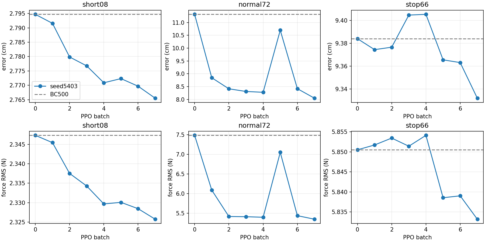
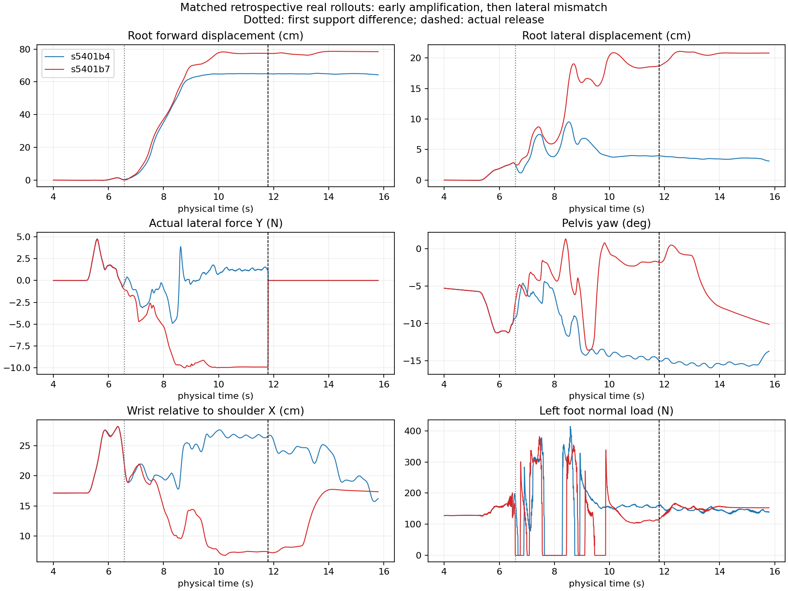

# INTERACTIVE_INCREMENT后续：PPO收益归因/保留、F数据资格、定向审计

三个工作流独立记账。BC500冻结；没有新增Teacher搜索、Expert PPO或PPO数值合同修改。旧记录和失败保留。本轮旧模型评价全部retrospective，新5403为单seed开发验证，不称新封存泛化或完整多seed统计证明。

## A0：中期收益真实，但主要改善保持，存在质量取舍

|模型|8cm误差cm/力N|72cm误差cm/力N|66cm停止误差cm/力N|
|---|---|---|---|
|BC500|2.795/2.347|11.316/7.485|9.384/5.851|
|5401 batch4|2.768/2.329|8.303/5.403|9.348/5.829|
|5402 batch4|2.801/2.350|8.463/5.447|9.408/5.839|
|5401 batch7|2.751/2.316|18.494/8.922|9.329/5.840|

四种模型在各条件使用相同真实物理初态、完整BFM/action/last-z/force历史、固定评价随机种子5417、相同物理和任务。全部起点audit逐值一致，旧三条件指标复现；5402无接触补齐。每条完整真实qpos及逐步动作保存在本轮私有输出。

72cm分阶段表明：batch4的主要收益来自保持时少超前、少侧向牵拉；并非明显更快起步或全阶段都更好。5401b4持续推进X误差9.96cm（BC9.60），X力6.10N（BC6.07），相近；保持XYZ力分别约.99/1.23/.83N（BC5.99/7.43/1.84）。同时移动期滑移峰值增至.695m/s（BC该段.303、全回合.385），末段偏航仍约−15°。持续阶段滑移p95也由.027增至.037m/s；保持阶段则由.049降至.0031m/s，保持期双足路径从约41/19cm降至.34/.25cm，显示确有阶段间质量取舍。5402b4有类似收益和取舍。完整XYZ/支撑/滑移/实际关节及q_PD分段在evidence中，不能只以全回合均值宣称运动质量全面改善。

按评价前登记的物理单位严重保护及近距/停止容差，两份batch4都满足A1启动条件。5401b7触发长距误差与滑移保护。阈值是本轮已登记选模规则，不追溯改变#53结论或设为所有未来任务的永久门槛。

## A0：第一分叉更符合(ii)闭环传播放大

4秒同状态：raw差异RMS.000169、合法z夹角.074°、五子步q_PD RMS差异.00284°。6.5秒同状态q_PD RMS差异仍约.00474°。在双方自己访问的236个高层状态上，原控制器通过对应BFM观测、实际上一z和五子步插值重算，全部原q_PD复现误差为0。固定五个真实观测上的反事实动作比较不等于五步反事实物理rollout。

实际闭环4–5秒root最大差.0021cm；5–6秒最大差.049cm。随后6.54秒出现持续100ms的1mm root分叉；6.585秒首次支撑状态不同：batch4左脚载荷179N、足点高3.45cm，batch7左脚仅.92N、足点高5.16cm，已发生卸载/抬足差异；6.605秒力差持续超过1N，6.665秒root差持续超过1cm。7–8秒root最大差4.88cm、腕相对肩差5.72cm；保持前已显著侧向失配。因此不支持“前段一致、最后才停止失配”，也没有证据说某个起步瞬间已经输出巨大错误命令；支持微小策略差异经身体/接触/支撑反馈放大。未通过本轮证据指定唯一关节或critic为根因。

旧5401每批接受2–3次actor更新，联合KL约.0159–.0198，clip fraction约.408–.464，raw均值RMS更新约8.93e−5–9.96e−5。5402接受2–9步，数值合同未放宽。固定抽样实际on-policy状态的梯度余弦：第4批long/stop≈.010；第7批long/near≈−.032、long/stop≈.026、near/stop≈−.020，接近正交。第4批相应near样本缺失明确保留，不伪造全任务覆盖。该廉价测量不证明或排除长期干扰，不作梯度手术，不用critic EV独立归因。

## A1：新seed5403，开发选模保留收益；继续训练非单调

从冻结BC500 actor/normalizer开始，fresh critic/Adam，固定std.008、原rawGaussian概率、GAE/bootstrap、clip.15、联合KL.02和Adam回滚。最大7×768真实决策，每批不可覆盖checkpoint；评价在独立进程，固定5417，检查前后训练CPU/CUDA/action采样器/task采样器/NumPy/Python RNG与物理q/qvel/last-z/time不变。保持训练回合延续，不为了评价重置它。

本轮按要求使用独立评价且保留训练回合延续；旧5401在开发评价后重新抽样训练回合。因此5403是新seed、受控合同下的保留验证，不是对“只有seed发生变化”的严格因果复现，也不能把任何改善全部归因于评价隔离。

选模事前定义：先严重保护，72cm主要误差和力各至少改善5%，8cm/停止误差在BC+.5cm、力在BC+.25N内，再按公开物理成本选开发best。另独立报告末轮及全部曲线；best-checkpoint保留收益不等于后续训练稳定。

|批次|8cm cm/N|72cm cm/N|停止 cm/N|严重保护|
|---|---|---|---|---|
|0|2.795/2.347|11.316/7.485|9.384/5.851|通过|
|1|2.792/2.345|8.845/6.088|9.374/5.852|normal72:slip|
|2|2.780/2.338|8.414/5.415|9.377/5.853|通过|
|3|2.777/2.334|8.310/5.410|9.405/5.851|通过|
|4|2.771/2.330|8.278/5.396|9.405/5.854|通过|
|5|2.772/2.330|10.698/7.052|9.366/5.839|通过|
|6|2.770/2.328|8.418/5.436|9.363/5.839|通过|
|7|2.765/2.326|8.047/5.346|9.332/5.833|通过|

事前规则选中同一个 **5403/batch7**，同时也是末轮。72cm相对BC500误差−28.89%、力−28.57%；短请求/停止在容差内，无接触真实力为0、没有严重边界。batch1虽已有平均收益，却因滑移触发保护被排除；不能只按误差最低选择。

两个层次分开：**(1)本轮best-checkpoint selection确实保留了真实开发收益；(2)没有证明持续稳定改善**。batch5曾回退至10.698cm/7.052N，6/7又恢复。只有一个新seed、有限已暴露开发条件，无新盲测或统计显著泛化结论，不将其自动替换全部任务的BC500基线。

新末轮也有质量代价：72cm持续推进滑移峰值.666m/s、p95 .038m/s（BC .303/.027），保持段XYZ力1.69/1.58/.65N，显著低于BC，但末段yaw仍约−15.15°。q_PD最大20ms目标变化51.47°，实际关节最大5ms变化1.54°，不是同一物理量；无力矩饱和。它保留了有用反馈，未解决所有运动质量问题。完整轴向/分段见[物理表](RETENTION_PHASE_TABLES.md)。

7批共5376真实决策；actor实际接受14步，critic为首批100预热＋126独立更新。8次独立评价的RNG/物理状态隔离全部通过。逐批KL、clip fraction、实际raw变化、正负优势概率变化和完整任务/阶段决策计数保存于evidence，critic EV不作为成功判据。

各图纵轴独立缩放；短请求约0.03cm的变化不应被视觉上等同于长距约3cm收益。

## B：资格不足，停止校准

96次历史完整搜索=712条实际候选预测。20个shadow状态有180条F/物理分数配对（每状态9），其中12接触、8接触前无力。最多仅4个独立Student回合：normal72/short08/stop66/mid24；共享初始前缀使“4”仍只是保守上界，不是20/180/712组独立标签。低于约10独立接触组，按预定门槛不拟合contact-only/F-only/F+contact，也不对不足数据做训练集相关性包装。

20个状态的原BFM观测可从已保存真实控制行匹配，previous-z、候选proposal和原生资产存在；每个候选的实际首z/action没有显式张量档案，需按原命令/插值/冻结BFM重建才能补齐。其余532条没有保存F分数，并含#53已知错误跨reset区间的受影响预测；本轮均不直接准入。离线补算不会产生新的独立回合，所以没有新增F计算/物理查询。校准主张暂停，不据此宣判FB方法整体无效。

## C：只读审计

详见RETENTION_CODE_AUDIT.md。关键结果：固定任务CrossResetState的现有3项跨reset逐值物理回放成立；checkpoint/normalizer身份、45/128替换的索引、34正确标签去重与F源码输入合同核实。明确记录两个范围限制：快照不恢复NumPy Generator；旧开发评价共享Task并随后重置训练回合，会影响后续课程/状态流。原始记录保留，本轮未修复旧helper、未撤销已复现的物理结果，未把这些限制宣布为退化的唯一原因。

## 复查与重现

- 预登记：[retention_protocol.json](retention_protocol.json)。固定模型与评价：[retention_eval.py](retention_eval.py)。
- 归因：[retention_diagnose.py](retention_diagnose.py)；曲线仅由保存的真实物理结果生成，不把固定状态BFM重算当作真实反事实rollout。
- 新seed：[retention_ppo.py](retention_ppo.py)；只在A0通过后执行，原始checkpoint不覆盖，评价输出逐批保存。
- 数据资格：[ranking_eligibility.py](ranking_eligibility.py)。审计：[RETENTION_CODE_AUDIT.md](RETENTION_CODE_AUDIT.md)。
- 完整聚合指标与身份：[retention_artifacts/evidence.json](retention_artifacts/evidence.json)。私有服务器原轨迹/模型由该文件路径索引，不上传权重或原始轨迹。

## 身份、成本与下一决策

5403/batch7 SHA **c1b9f7c04b4c0154b8644929bbeebbd64f55a227b199e6f5c7ed0dc116257f76**。原始位置为本轮stage的 `runs/A1-train-5403/candidate-7.pt`，初始至第7批全保留。

实测累计job：A0 **768.16s**、A1 **3543.73s**、B **14.08s**、C **6.05s**。另明确预留CPU只读分析A0 100/B30/C120秒，非伪造实测；含该预留总计 **4582.02s**。A1父进程等待时间与独立评价子进程时间都计入，偏保守。新输出约 **0.759GiB**（整个stage runs合并，低于A6GiB/B2GiB）；0新搜索、0新增BC、0Expert PPO，5376 Student RL。48条固定物理评价=16旧模型复核＋32新seed逐批评价，不是48种独立泛化条件。GPU owned任务全部结束，stop标记已写入。

**下一推荐仅为决策、未执行**：保留BC500和5403b7独立身份，先在少量新的起步/支撑状态及停止组合中验证同一候选的收益与滑移代价；训练侧保留独立评价和不可覆盖检查点。若要修复旧快照RNG/旧runner生命周期，另开回归小轮。不要根据本轮曲线直接延长PPO，也不在只有4个独立回合的FB资料上强行拟合。

既有BC500 SHA a6688f292d8a212bebed4384532026ce3f703269165cd74afd0d0d635d4d4e1e；BFM33f410c190877a1348dc3fafa3f0e97b277ad0251b39615ff98e5bd26369e361。
A0运行48e756fadfeffcb5cf447e21d114344044291cf2；同状态分析及5403运行8ef38c44ce71b910d11af10e3abe44b2bff9283e。源码/输出隔离；不改main、共享BFM/PD或其他任务；本轮完成即停止。

虚线标记真正释放；点线标记首次支撑差异。图来自实际qpos/受力轨迹，不是候选预测或参考动画。BC500保持冻结，旧INTERACTIVE_INCREMENT正式结果完整保留。
